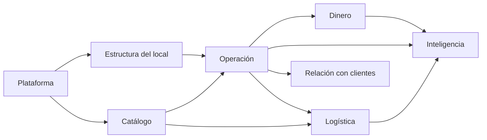

# 00B - Visión del Dominio

**Estado:** Propuesto

Mapa del negocio que el software representa. No describe pantallas ni tablas, sino **qué existe, quién participa y qué ocurre**.

## 1. Contextos del dominio

| Contexto | Responsabilidad | Módulos relacionados |
|---|---|---|
| **Plataforma** | Quién es cliente, qué contrató, qué módulos tiene activos | Empresas (06), Restaurantes (07), Configuración (28) |
| **Estructura del local** | Cómo está organizado físicamente cada restaurante | Zonas (09), Mesas (10), Punto de Producción (19) |
| **Catálogo** | Qué se vende y a qué precio | Carta Digital (11), Productos (12), Categorías (13), Recetas (14) |
| **Operación** | Cómo se toman, producen y entregan las órdenes | Órdenes (15 a 17), Cocina (18), Punto de Producción (19) |
| **Dinero** | Cómo se cobra, factura y liquida | Caja (20), Facturación (21), Propinas y liquidaciones (26A) |
| **Logística** | Qué se compra, se guarda y se consume | Inventario (22), Compras (23), Proveedores (24) |
| **Relación con clientes** | Quién compra, qué le damos | Clientes (25), Cupones (25A) |
| **Inteligencia** | Qué está pasando en el negocio | Estadísticas (26), Dashboard (27) |
| **Transversal** | Seguridad, auditoría, notificaciones | Usuarios y permisos (29), Auditoría (30), Seguridad (32) |

## 2. Actores

| Actor | Qué hace |
|---|---|
| **Administrador de empresa** | Gestiona todos los restaurantes de su empresa, ve consolidados |
| **Administrador de restaurante** | Configura zonas, mesas, cartas, productos, personal; ve informes |
| **Mesero** | Atiende mesas de su zona y toma órdenes en la tablet; acumula propinas |
| **Cocinero / bartender** | Prepara las comandas que le llegan a su punto de producción |
| **Cajero / encargado de pedidos externos** | Registra órdenes de mostrador, WhatsApp y domicilio; cobra |
| **Domiciliario** | Lleva órdenes a domicilio; se le liquida por servicio |
| **Cliente final** | Pide por QR, web o WhatsApp; puede estar registrado |
| **Proveedor** | Suministra insumos (relación en Compras) |

## 3. Canales de entrada de órdenes

1. Tablet de zona (mesero).
2. QR de mesa (cliente).
3. QR de pedidos rápidos para llevar (cliente).
4. WhatsApp (lo captura una persona encargada).
5. Sitio de domicilios o redes sociales (cliente).
6. Plataformas externas como Rappi o Uber Eats (fase posterior).

Detalle y comportamiento por canal en `17A`.

## 4. Conceptos centrales

- **Empresa → Restaurante → Zona → Mesa.** Jerarquía estructural.
- **Orden → Ítems de orden.** Una orden contiene ítems; cada ítem se produce en un punto de producción.
- **Comanda.** La parte de una orden que se envía a un punto de producción.
- **Cuenta.** Lo que se cobra; puede agrupar varias órdenes de una misma mesa.
- **Turno de caja.** Periodo en que un cajero responde por el dinero.
- **Jornada operativa.** El "día" del restaurante, que no siempre coincide con el día calendario (un bar cierra pasada la medianoche).

## 5. Eventos importantes del dominio

| Evento | Quién lo origina | Qué dispara |
|---|---|---|
| Orden creada | Mesero, cliente, cajero | Comanda a punto de producción, aviso en pantallas |
| Comanda abierta en cocina | Cocina | Estado "en proceso", opción de imprimir tirilla |
| Comanda despachada | Cocina | Pestaña "Listos", aviso al mesero |
| Orden entregada | Mesero | Estado final de producción |
| Orden cancelada | Usuario con permiso | Auditoría, ajuste de inventario si aplica |
| Cuenta pagada | Cajero o pasarela | Registro en caja, factura, propina |
| Orden lista para recoger | Cocina | Notificación al cliente (WhatsApp) |
| Orden salió a domicilio | Cocina o encargado | Notificación al cliente, asignación a domiciliario |
| Cierre de turno de caja | Cajero | Arqueo, informe del turno |
| Cierre de jornada | Administrador | Reportes diarios, informe por mesero |

## 6. Preguntas de dominio abiertas

- ¿"Despachado" por cocina y "entregado" al cliente son estados distintos? **Recomiendo que sí** (ver ADR-006 en `37`). `[POR CONFIRMAR]`
- ¿Un cliente que pide por QR puede pedir varias veces en la misma mesa y pagar una sola cuenta al final?
- ¿Una mesa puede tener varias cuentas separadas?
- ¿Quién puede cancelar una orden ya en proceso?
