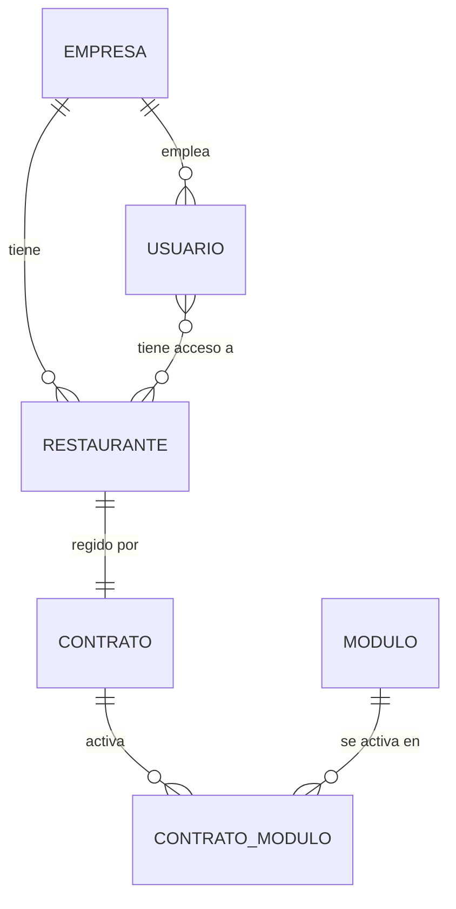

# 02A - Multi-tenencia y Licenciamiento Modular

**Estado:** Propuesto

Este documento resuelve dos preguntas que condicionan todo el modelo de datos:

1. **¿Cómo se aíslan los datos** de una empresa respecto a otra?
2. **¿Cómo se activa o desactiva cada módulo** según lo que el cliente contrató?

## 1. Estructura de clientes

Tu requisito original: una **empresa principal** puede tener uno o varios **restaurantes hijos**, y cada restaurante puede tener un **contrato de software independiente**. Un restaurante solo es "hijo" de una empresa cuando hace falta.

### Propuesta

- **Toda cuenta de cliente es una Empresa.** Un restaurante independiente se crea como una empresa con un solo restaurante (la jerarquía existe pero es invisible para el usuario).
- La **Empresa** es el **tenant**: la frontera de aislamiento de datos.
- El **Contrato** pertenece a un **Restaurante**, no a la empresa. Así dos restaurantes de la misma empresa pueden tener módulos distintos.
- Un usuario puede tener acceso a uno o varios restaurantes de su empresa mediante asignaciones.

### Consecuencia

Una empresa con tres restaurantes puede tener el restaurante A con "completo", el B con "solo pedidos" y el C suspendido por falta de pago, sin que unos afecten a los otros. Los consolidados de la empresa solo muestran la información de los módulos a los que tiene derecho.

## 2. Aislamiento de datos

### Opciones evaluadas

| Opción | Ventajas | Desventajas |
|---|---|---|
| **A. Base compartida, `empresa_id` en cada tabla** | Operación simple, un solo esquema, migraciones únicas, barata | Un error de consulta puede cruzar datos; hay que protegerlo bien |
| B. Esquema por empresa | Aislamiento más fuerte, copias por cliente más fáciles | Migraciones multiplicadas, más complejo con muchos clientes pequeños |
| C. Base de datos por empresa | Máximo aislamiento | Operación y costo difíciles con cientos de clientes pequeños |

### Recomendación: opción A con defensa en profundidad

Para un equipo pequeño y clientes pequeños, la base compartida es la opción realista. Para reducir el riesgo se propone:

1. **`empresa_id` obligatorio** en todas las tablas de negocio (RG-02).
2. **Row Level Security (RLS) de PostgreSQL**: la base misma rechaza filas que no correspondan a la empresa de la sesión.
3. **Contexto de tenant obligatorio** en cada petición: el backend fija la empresa de la sesión antes de cualquier consulta.
4. **Pruebas automáticas de aislamiento**: pruebas que intentan leer datos de otra empresa y deben fallar.
5. La arquitectura **no impide migrar** más adelante a esquema por empresa para un cliente grande, si fuera necesario.

> **[POR CONFIRMAR]** Esta recomendación asume muchos clientes pequeños. Si el primer cliente fuera una empresa grande con exigencias contractuales de aislamiento físico, la opción B o C podría ser necesaria para ese cliente.

## 3. Licenciamiento modular

### Catálogo de módulos (propuesto)

| Código | Módulo | Depende de |
|---|---|---|
| `base` | Empresas, restaurantes, usuarios, productos, categorías, configuración | (siempre activo) |
| `pedidos` | Zonas, mesas, QR, órdenes, cocina, puntos de producción, impresión | `base` |
| `caja` | Caja, POS de mostrador, facturación | `base` |
| `inventario` | Insumos, recetas, compras, proveedores | `base` |
| `propinas` | Meseros, turnos, propinas, liquidaciones | `base`, `caja` |
| `domicilios` | Zonas de envío, domiciliarios, notificaciones WhatsApp | `pedidos` |
| `pagos_linea` | Pasarela de pagos | `caja` |
| `fidelizacion` | Cupones, puntos | `base` |
| `reportes_avanzados` | Estadísticas completas, exportación | `base` |
| `integraciones` | Rappi, Uber Eats, agregadores | `pedidos` |

Las dependencias son **obligatorias** y se validan al activar un módulo. Las integraciones entre módulos que son **opcionales** (por ejemplo, pedidos que descuentan inventario) solo se activan si ambos están presentes.

### Paquetes comerciales (hipótesis a validar)

| Paquete | Módulos |
|---|---|
| **Pedidos** | `base` + `pedidos` |
| **Gestión** | `base` + `caja` + `inventario` |
| **Completo** | todos los módulos del MVP + los que se vayan lanzando |

> El paquete **Gestión** (solo facturación e inventario) exige que `caja` incluya un **POS de mostrador** que no dependa del módulo `pedidos`. Ver ADR-007 en `37`.

### Cómo se aplica en el sistema

Una función de módulo se protege en **tres capas**:

1. **Backend:** cada ruta de la API declara a qué módulo pertenece; si el contrato del restaurante no lo incluye, responde "módulo no contratado".
2. **Interfaz:** el menú y las pantallas solo muestran módulos activos.
3. **Datos:** los módulos no contratados no generan datos ni eventos. Si se activa un módulo después, empieza desde cero para ese restaurante, salvo que se defina una migración inicial.

### Estados de un contrato

| Estado | Efecto |
|---|---|
| **Prueba** | Acceso completo por tiempo limitado |
| **Activo** | Funcionamiento normal |
| **Suspendido** | Solo lectura; no se pueden crear órdenes ni cobrar. Nunca se pierden datos |
| **Cancelado** | Acceso solo para exportar datos durante un plazo definido |

> **Regla importante:** suspender no puede interrumpir un servicio en plena operación sin aviso. Se sugiere periodo de gracia y avisos previos. `[POR CONFIRMAR]` con el modelo comercial (`42`).

## 4. Qué debe resolverse antes de construir

- Definir si un usuario puede pertenecer a más de una empresa (por ejemplo un contador externo). Recomendación: **no en el MVP**.
- Definir la política de datos al cancelar un contrato.
- Confirmar el catálogo de módulos con el modelo comercial (`42`).
