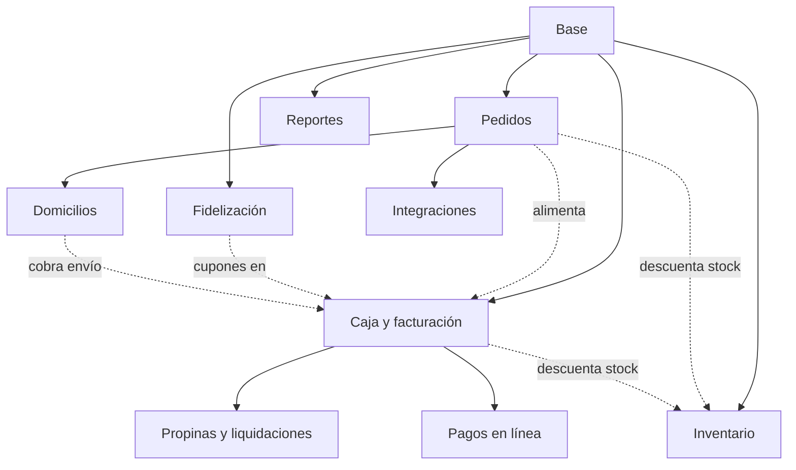
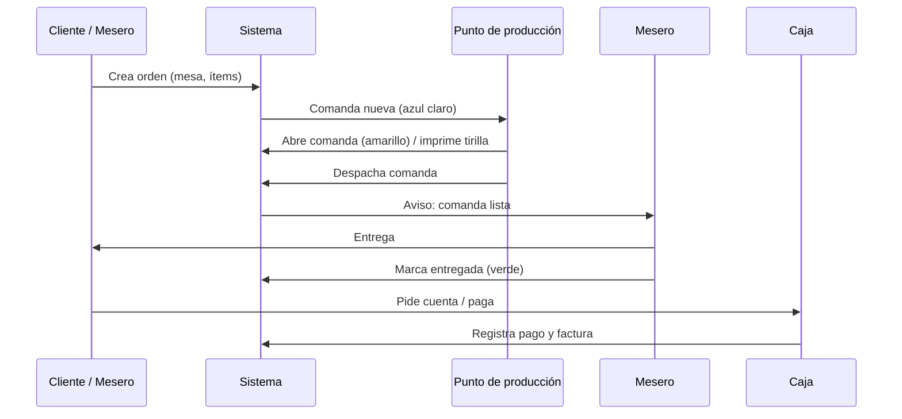

# 03 - Arquitectura Funcional

**Estado:** Propuesto

Describe **qué hace el sistema y cómo se organiza para el usuario**: aplicaciones, módulos, canales y dependencias. El cómo técnico está en `04`.

## 1. Aplicaciones (interfaces web)

Todas son aplicaciones web responsive servidas desde el mismo sistema.

| Aplicación | Quién la usa | Dispositivo típico | Función principal |
|---|---|---|---|
| **Administración de empresa** | Administrador de empresa | Computador | Gestionar restaurantes, ver consolidados |
| **Administración de restaurante** | Administrador de restaurante | Computador / tablet | Zonas, mesas y QR, cartas, productos, personal, informes |
| **Tablet de zona (mesero)** | Mesero | Tablet táctil | Ver mesas de su zona, tomar y enviar órdenes |
| **Cocina / Punto de producción (KDS)** | Cocinero, bartender | Pantalla fija o tablet | Ver comandas, abrir, imprimir tirilla, despachar |
| **Caja / Mostrador** | Cajero, encargado de externos | Computador / tablet | Cobrar, órdenes de mostrador y WhatsApp, turnos de caja |
| **Carta digital del cliente** | Cliente final | Celular (por QR o enlace) | Ver carta, pedir, pagar, dejar datos de entrega |
| **Domiciliario** | Domiciliario | Celular | Ver entregas asignadas y cambiar su estado `[fase posterior]` |

## 2. Módulos

| Módulo | Contenido | Documentos |
|---|---|---|
| **Base** | Empresas, restaurantes, usuarios y roles, productos, categorías, configuración, auditoría | 06 a 08, 12, 13, 28 a 30 |
| **Pedidos** | Zonas, mesas, QR, carta digital, órdenes, estados, flujo, cocina, puntos de producción, impresión | 09 a 11, 15 a 19, 10A, 15A, 17A, 19A |
| **Caja y facturación** | Caja, POS de mostrador, facturación, impuestos | 20, 21, 21A |
| **Inventario** | Insumos, recetas, compras, proveedores | 14, 22 a 24 |
| **Propinas y liquidaciones** | Meseros, turnos, propinas, pago a domiciliarios | 08A, 26A |
| **Domicilios** | Zonas de envío, domiciliarios, notificaciones | 15B, 31B |
| **Pagos en línea** | Pasarela de pagos | 20A |
| **Fidelización** | Clientes, cupones | 25, 25A |
| **Reportes** | Estadísticas y dashboard | 26, 27 |
| **Integraciones** | Plataformas externas | 31A |

## 3. Dependencias

- **Línea continua:** dependencia obligatoria.
- **Línea punteada:** integración opcional; cada módulo funciona sin ella.

## 4. Canales de orden

| Canal | Quién crea la orden | Mesa asociada | Datos extra que pide |
|---|---|---|---|
| Tablet de zona | Mesero | Mesa real | Notas |
| QR de mesa | Cliente | Mesa real (identificada por el QR) | Nombre (opcional) |
| QR de pedidos rápidos | Cliente | Mesa externa | Nombre, teléfono |
| WhatsApp | Encargado | Mesa externa | Nombre, teléfono, dirección y zona de envío si es domicilio |
| Domicilio web / redes | Cliente | Mesa externa | Nombre completo, dirección, teléfono |
| Plataformas (fase posterior) | Sistema (integración) | Mesa externa | Datos de la plataforma |

Todos los canales terminan produciendo **la misma entidad: una orden**, que sigue el mismo flujo de cocina, caja y facturación. El detalle por canal vive en `17A`.

## 5. Flujo principal

## 6. Funcionalidades clave a nivel de producto

- **Zona como unidad de operación:** cada zona tiene su carta, mesas, meseros, tablets y punto de producción por defecto.
- **Enrutamiento por producto:** cada producto indica a qué punto de producción va (un plato a cocina, una cerveza al bar), así una misma orden puede dividirse en comandas.
- **Mesa externa:** permite ingresar órdenes sin mesa física.
- **Carta por zona:** una zona de bar solo muestra bebidas alcohólicas, una de comida rápida solo su menú.
- **Avisos y colores** coherentes en todas las pantallas.

## 7. Fuera de este documento

Reglas de cada módulo → `36`. Casos de uso → `35`. Detalle de pantallas → `33` y `34`.
