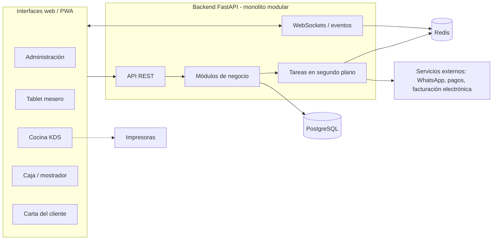

# 04 - Arquitectura Técnica

**Estado:** Propuesto

Cada decisión de este documento es una **recomendación inicial** y se formaliza en `37`. El stack de partida es **Vue.js + FastAPI** (el que ya usas), pero se evalúa si conviene algo distinto en cada capa.

## 1. Visión general

**Monolito modular** desplegado como una sola aplicación backend, con varias interfaces web que lo consumen.



## 2. Stack recomendado

| Capa | Recomendación | Por qué | Alternativa |
|---|---|---|---|
| **Frontend** | **Vue 3** + Vite + TypeScript, Pinia, Vue Router | Ya lo dominas; buen rendimiento; soporta PWA | Nuxt si más adelante necesitas renderizado en servidor para la carta pública |
| **UI** | Librería de componentes táctil (por definir) | Reduce tiempo; coherencia | Componentes propios con Tailwind |
| **Backend** | **FastAPI** (Python) | Ya lo dominas; async nativo; WebSockets; tipado con Pydantic | Django si priorizaras un panel de administración incluido |
| **Base de datos** | **PostgreSQL** | Transacciones sólidas, Row Level Security, JSONB, buen soporte | — (no recomiendo NoSQL para este dominio) |
| **ORM y migraciones** | SQLAlchemy 2 + Alembic | Estándar en FastAPI | SQLModel |
| **Cache, pub/sub, colas ligeras** | **Redis** | Eventos en tiempo real entre instancias; cola de tareas | PostgreSQL LISTEN/NOTIFY al inicio |
| **Tareas en segundo plano** | ARQ, Dramatiq o Celery (por decidir) | Notificaciones, reportes, reintentos | — |
| **Despliegue** | Contenedores (Docker) en un servidor/VPS gestionado | Simple y barato al inicio | Plataforma gestionada (PaaS) |

> **[POR CONFIRMAR]** La elección concreta de librería de UI y de cola de tareas se resuelve en el primer corte vertical.

## 3. Organización del código (monolito modular)

Cada módulo de negocio es un paquete con fronteras claras. Un módulo **no importa** las tablas de otro; usa su interfaz pública o eventos internos (RG-26).

```
backend/
  app/
    core/            # configuración, seguridad, tenant, auditoría, base de datos
    modules/
      base/          # empresas, restaurantes, usuarios, productos, categorías
      pedidos/       # zonas, mesas, órdenes, cocina, puntos de producción
      caja/          # caja, facturación
      inventario/
      propinas/
      domicilios/
      ...
    api/             # rutas, cada una declara su módulo
    realtime/        # WebSockets y eventos
frontend/
  apps/
    admin/
    tablet/
    kds/
    caja/
    carta/           # carta pública del cliente
  packages/
    ui/              # componentes compartidos
    api-client/
```

Esta separación permite activar módulos por contrato (`02A`) y, si algún día hace falta, extraer uno a un servicio aparte.

## 4. Tiempo real

Necesidad: cuando se crea una orden, la cocina y la tablet deben verlo en segundos; cuando cocina despacha, el mesero debe enterarse.

**Recomendación:**
- **WebSockets** para tablet, cocina y caja (conexiones persistentes y bidireccionales).
- **SSE o polling corto** como respaldo para la carta pública del cliente, donde basta con ver el estado de su orden.
- **Redis pub/sub** para distribuir eventos si hay más de una instancia del backend.
- Los eventos son **avisos**, no la fuente de verdad: si un cliente se desconecta y reconecta, **vuelve a pedir el estado** actual a la API.

### Evitar órdenes duplicadas o perdidas

- Cada orden se crea con una **clave de idempotencia** generada en el cliente (RG-20).
- La orden se guarda en base de datos **antes** de emitir cualquier evento.
- La cocina confirma la **recepción** de la comanda; si no hay confirmación, la interfaz lo muestra al mesero.
- Reintentos con la misma clave devuelven la orden original.

## 5. PWA y resiliencia

- Las aplicaciones se sirven como **PWA** (instalables, caché de recursos estáticos).
- **Modo degradado:** si se cae internet, la tablet debe mostrar claramente que no está conectada, y no crear órdenes que luego se pierdan sin aviso.
- El diseño detallado (cola local, reintentos, qué se permite sin red) se escribe en `33A`. Para el MVP basta con detección de conexión y avisos claros; una cola offline completa es una decisión posterior.

## 6. Impresión de tirillas

Imprimir desde una web app a una impresora térmica es **uno de los puntos más delicados** del proyecto.

| Opción | Cómo funciona | Pros | Contras |
|---|---|---|---|
| **A. Impresión del navegador** (`window.print` con estilos de 80 mm) | El navegador abre el diálogo de impresión | Sin instalar nada | Diálogos molestos, poco control del corte y formato |
| **B. Agente local** | Programa pequeño en un PC del local que recibe trabajos y habla ESC/POS con la impresora | Control total, impresión silenciosa | Hay que instalarlo y mantenerlo |
| **C. WebUSB / WebSerial** | El navegador habla con la impresora directamente | Sin servidor local | Soporte limitado de navegadores y dispositivos (tablets) |
| **D. Impresión por red o nube** | Impresora con servicio de impresión remota | Funciona sin PC local | Depende del modelo y del servicio |

**Recomendación inicial:** prototipar **A** para el primer corte vertical y diseñar la arquitectura para que **B o D** se puedan agregar sin tocar la lógica de órdenes (una "cola de impresión" en el backend que cualquier agente consume). **La decisión final debe tomarse probando con las impresoras que usan restaurantes reales.** Ver ADR-005.

## 7. Seguridad (resumen; detalle en `32`)

- Autenticación con tokens de corta duración y renovación.
- Autorización por rol y módulo contratado.
- QR de mesa con **token firmado y revocable** (no solo un identificador de mesa).
- HTTPS obligatorio, cabeceras de seguridad, límites de peticiones.
- Datos de tarjetas nunca pasan por el sistema (RG-19).

## 8. Observabilidad y operación

- Registros estructurados con identificador de petición y de empresa.
- Monitoreo de salud del servicio y de errores.
- **Respaldos automáticos** de PostgreSQL con prueba periódica de restauración.
- Entornos separados: desarrollo, pruebas, producción.
- Detalle en `40`.

## 9. Integraciones externas (resumen)

| Integración | Estrategia inicial |
|---|---|
| Facturación electrónica | Proveedor tecnológico por API, detrás de una interfaz propia (para poder cambiar de proveedor) |
| Pasarela de pagos | Elegir una; interfaz propia por si hay que añadir otras |
| WhatsApp | API oficial recomendada; evaluar costos y plantillas |
| Rappi, Uber Eats | Fase posterior; evaluar agregador vs. integración directa |

Cada integración externa vive tras un **adaptador** para que cambiar de proveedor no afecte al resto del sistema.

## 10. Preguntas técnicas abiertas

- Librería de UI y sistema de diseño.
- Cola de tareas definitiva.
- Estrategia de impresión definitiva.
- Alcance exacto de lo offline en el MVP.
- Dónde alojar (proveedor, región) y costos.
