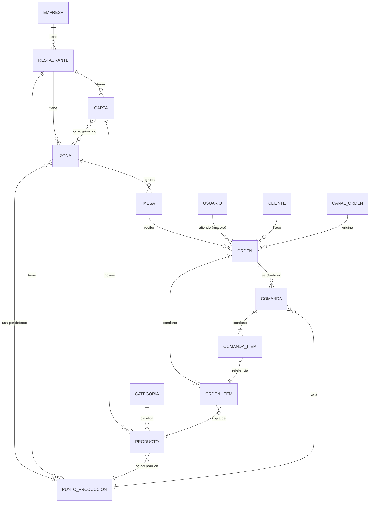
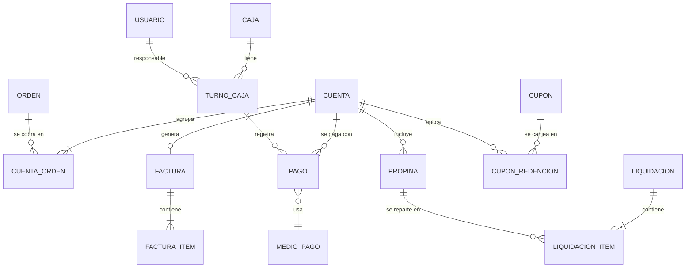

# 05 - Modelo de Datos

**Estado:** Borrador (versión inicial)

Vista de alto nivel de las entidades y sus relaciones. **No** es todavía el esquema final: los campos son orientativos y se refinan al escribir cada módulo. Reglas generales de datos en `02`; aislamiento por empresa en `02A`.

## 1. Convenciones

- Todas las tablas de negocio llevan `id` (UUID), `empresa_id`, `creado_en`, `actualizado_en` y, si aplica, `eliminado_en` (borrado lógico). Ver RG-01, RG-02, RG-10 y RG-11.
- Importes: decimal exacto + moneda (RG-03, RG-04).
- Las órdenes copian nombre y precio del producto (RG-13).
- Nombres de tablas y campos: español, minúsculas, con guion bajo `[POR CONFIRMAR]`.

## 2. Mapa de entidades por contexto

### Plataforma
`empresa`, `restaurante`, `contrato`, `modulo`, `contrato_modulo`

### Estructura del local
`zona`, `mesa`, `punto_produccion`, `impresora`, `dispositivo` (tablet/pantalla), `qr_acceso`

### Personas
`usuario`, `rol`, `permiso`, `rol_permiso`, `usuario_restaurante` (acceso), `mesero_zona`, `turno_mesero`, `horario`, `domiciliario`, `cliente`, `cliente_direccion`

### Catálogo
`carta`, `carta_zona`, `categoria`, `producto`, `producto_variante`, `modificador_grupo`, `modificador_opcion`, `producto_punto_produccion`, `combo`, `combo_item`

### Logística
`insumo`, `unidad_medida`, `receta`, `receta_item`, `proveedor`, `compra`, `compra_item`, `movimiento_inventario`

### Operación
`canal_orden`, `sesion_mesa`, `orden`, `orden_item`, `orden_item_modificador`, `comanda`, `comanda_item`, `historial_estado`, `trabajo_impresion`

### Dinero
`cuenta`, `cuenta_orden`, `pago`, `medio_pago`, `caja`, `turno_caja`, `movimiento_caja`, `factura`, `factura_item`, `impuesto`, `propina`, `liquidacion`, `liquidacion_item`, `cupon`, `cupon_redencion`

### Domicilios
`zona_envio`, `tarifa_envio`, `entrega`

### Transversal
`notificacion`, `auditoria`, `configuracion`

## 3. Diagrama central (estructura y operación)

## 4. Diagrama de dinero

## 5. Decisiones de modelado que requieren confirmación

| Tema | Propuesta | Impacto |
|---|---|---|
| **Estado de orden vs. estado de ítem** | Estado **por ítem de comanda**; el estado de la orden se **deriva** | Permite que un plato esté listo y otro en proceso, y que cocina y bar trabajen aparte. Ver ADR-006 |
| **Estados** | `pendiente_aprobacion`, `nuevo`, `en_proceso`, `despachado`, `entregado`, `cancelado` (ver `16`) | Tus cuatro colores cubren `nuevo`, `en_proceso`, `entregado`, `cancelado`; `despachado` es el estado de la pestaña "Listos" de cocina. **`[POR CONFIRMAR]`** |
| **Cuenta vs. orden** | Una cuenta puede agrupar varias órdenes de la misma mesa | Permite pedir varias veces y pagar una sola vez; permite dividir la cuenta |
| **Mesa externa** | Mesa especial por restaurante, de tipo `externa`, sin zona física | Mantiene un único flujo de órdenes |
| **Precio e impuesto** | Pendiente (ver RG-05 y ADR-010) | Afecta orden, factura y reportes |
| **Contrato por restaurante** | `contrato` ligado a `restaurante`, no a `empresa` | Ver `02A` |
| **Un cliente en varias empresas** | Cliente es **por empresa** (no global) | Evita cruzar datos personales entre empresas |
| **Personas: mesero** | Mesero es un `usuario` con rol, más datos de asignación (`mesero_zona`, `turno_mesero`) | Evita duplicar personas |
| **Domiciliario** | Entidad propia ligada a `usuario` opcional | Hay domiciliarios que no usan el sistema directamente |

## 6. Próximos pasos del modelo

1. Confirmar estados y vocabulario (`01`, `16`).
2. Definir campos de `orden`, `orden_item` y `comanda` al escribir `15`.
3. Definir esquema de permisos al escribir `08` y `29`.
4. Detallar el modelo de caja y facturación al escribir `20` y `21`.
5. Generar el esquema real con migraciones **solo después** del primer corte vertical.
