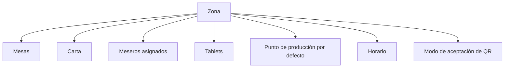

# 09 - Módulo Zonas

**Estado:** Propuesto

Una **zona** es un área del restaurante con identidad propia: comida corriente, comidas rápidas, a la carta, gourmet, bar. Es la unidad que une **carta, mesas, meseros, tablets y punto de producción**.

## 1. Qué contiene una zona

## 2. Ejemplos

| Zona | Mesas | Carta | Producción |
|---|---|---|---|
| Corrientes | 10 mesas | Almuerzos del día | Cocina |
| Rápidas | 6 mesas | Hamburguesas, perros, papas | Cocina |
| Bar | 8 mesas | Solo bebidas, incluido alcohol | Bar |
| Gourmet | 5 mesas | Carta de autor | Cocina |

## 3. Datos de una zona

| Campo | Descripción |
|---|---|
| Nombre y código | Visibles en tirillas y pantallas |
| Restaurante | A cuál pertenece |
| Orden de visualización | En la tablet y en reportes |
| Carta asociada | Qué productos ofrece (`11`) |
| Punto de producción por defecto | Destino de ítems sin destino propio (`19`) |
| Modo de aceptación de órdenes por QR | Libre, con aprobación, mesa abierta (`10A`) |
| Horario | Cuándo acepta órdenes |
| Estado | `activa`, `inactiva` |
| Meseros asignados | Ver `08A` |
| Tablets autorizadas | Dispositivos vinculados |

## 4. Tablets de zona

Una zona puede tener **una o más tablets**. Cada tablet:

- Se **autoriza** una vez por el administrador (código de emparejamiento).
- Muestra **solo las mesas de su zona**.
- Permite al mesero identificado tomar órdenes y ver el estado de ítems.
- Si hay varias tablets, todas ven el mismo estado en tiempo real.

## 5. Qué cambia entre zonas

| Aspecto | Puede variar por zona |
|---|---|
| Carta y precios | Sí |
| Productos disponibles (alcohol solo en bar) | Sí |
| Modo de aceptación de QR | Sí |
| Punto de producción por defecto | Sí |
| Propina sugerida | Sí (fase 2) |
| Horario | Sí |
| Impuestos | No: dependen del producto y del restaurante |

## 6. Reglas

- **RN-ZON-01.** Toda zona pertenece a un restaurante y tiene al menos una mesa activa o es una zona de solo mostrador.
- **RN-ZON-02.** No se puede desactivar una zona con mesas con sesión abierta o cuentas sin pagar.
- **RN-ZON-03.** Una zona tiene una carta activa en cada momento (puede cambiar por horario).
- **RN-ZON-04.** Las mesas de una zona heredan su carta, modo de QR y punto de producción por defecto, salvo excepción configurada.
- **RN-ZON-05.** Cambiar la carta de una zona no afecta a órdenes ya creadas (RG-13).

## 7. Preguntas abiertas

- ¿Una mesa puede cambiar de zona? (Recomiendo permitirlo solo si no tiene sesión abierta.)
- ¿Se necesitan zonas solo de mostrador sin mesas, como una panadería?
- ¿Una zona puede tener varias cartas simultáneas (para distintos clientes)? Recomiendo no.
