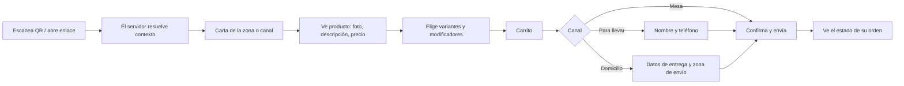

# 11 - Módulo Carta Digital

**Estado:** Propuesto

La **carta digital** tiene dos caras: la **configuración** que hace el administrador, y la **experiencia del cliente** al abrir un QR o un enlace. Es la interfaz más expuesta del sistema, y la que más importa que cargue rápido en un celular con mala señal.

## 1. Conceptos

| Concepto | Descripción |
|---|---|
| **Carta** | Conjunto de categorías y productos ofrecidos, con precios y disponibilidad |
| **Carta por zona** | Cada zona usa una carta (una carta puede usarse en varias zonas) |
| **Carta por horario** | Una zona puede cambiar de carta según la franja (desayuno, almuerzo, cena) |
| **Carta de domicilio / para llevar** | Carta que ven los QR externos y el sitio de domicilios; puede ser la misma o una versión reducida |

## 2. Configuración (administrador)

- Crear cartas y asignarlas a zonas y a canales externos.
- Seleccionar qué productos y categorías incluye cada carta.
- Ordenar categorías y productos.
- Precios por carta cuando difieran entre zonas o canales (por ejemplo, domicilio con precio distinto) `[POR CONFIRMAR]`.
- Marcar productos **agotados** al instante (`12`).
- Vista previa tal como la verá el cliente.

## 3. Experiencia del cliente

### Pantallas

1. **Inicio:** nombre del restaurante, zona y mesa (para confirmar), aviso si está cerrado o pausado.
2. **Carta:** categorías y productos, con búsqueda simple.
3. **Producto:** foto opcional, descripción, alérgenos o avisos, variantes, modificadores, nota, cantidad.
4. **Carrito:** resumen, total estimado, notas generales.
5. **Datos (solo si aplica):** nombre, teléfono, dirección.
6. **Confirmación:** número de orden y estado.
7. **Seguimiento:** estado actualizado de la orden (`16`).

## 4. Reglas de la experiencia

- **Total estimado:** se muestra al cliente, pero el precio definitivo lo calcula el servidor (`RN-ORD-01`).
- **Producto agotado:** se muestra como no disponible o se oculta, configurable.
- **Restaurante cerrado o pausado:** se informa y no se permite enviar.
- **Productos con restricción de edad** (por ejemplo licor): aviso explícito de que son para mayores de edad (`13`). Es una advertencia; no se puede verificar la edad de forma fiable desde el celular.
- **Moneda y formato** según el restaurante (RG-25).

## 5. Rendimiento y diseño (requisitos)

| Requisito | Motivo |
|---|---|
| Carga rápida en celulares y redes lentas | El cliente está en un local, no necesariamente con buena señal |
| Imágenes optimizadas y carga diferida | Evitar pantallas en blanco |
| **Sin instalar nada ni registrarse** para pedir en mesa | Reducir fricción |
| Accesible: texto legible, contraste adecuado | Público variado |
| Funciona en los navegadores móviles más comunes | Sin depender de un navegador específico |
| Mensajes claros ante errores | "No se pudo enviar, intenta de nuevo" |

Se sirve como una **aplicación web separada y ligera** (`carta/` en `04`), no como parte del panel administrativo.

## 6. Qué no hace la carta digital en el MVP

- Pagos en línea (`20A`, fase 2).
- Registro de clientes y direcciones guardadas (fase 2).
- Idiomas múltiples (la estructura lo permite después).
- Recomendaciones personalizadas.

## 7. Reglas

- **RN-CAR-01.** Una carta solo muestra productos activos y disponibles en la zona o canal.
- **RN-CAR-02.** El cliente nunca ve datos internos (costos, recetas, otros restaurantes).
- **RN-CAR-03.** El contexto sale del token (`RN-QR-02`); la carta no acepta restaurante, zona o mesa por parámetros.
- **RN-CAR-04.** La disponibilidad se refresca en tiempo real o al enviar; si un producto se agotó mientras el cliente decidía, se avisa y no se envía a medias.

## 8. Preguntas abiertas

- ¿Fotos obligatorias para cada producto? (Recomiendo opcionales.)
- ¿Los precios de domicilio pueden diferir de los de mesa?
- ¿Cuánto detalle de alérgenos se maneja? (Fuera del MVP; solo texto libre.)
