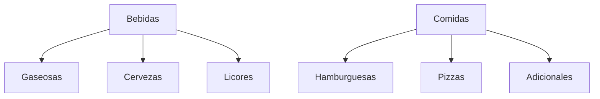

# 13 - Módulo Categorías

**Estado:** Propuesto

Las **categorías** organizan los productos en la carta, en las tablets y en los reportes. También pueden aportar valores por defecto (punto de producción, impuesto, restricciones).

## 1. Estructura

- **Hasta dos niveles** en el MVP: categoría y subcategoría (por ejemplo *Bebidas* → *Cervezas*).
- Cada producto pertenece a **una categoría**.
- El orden de las categorías se define por carta, no globalmente.

## 2. Datos de una categoría

| Campo | Descripción |
|---|---|
| Nombre | Visible para el cliente |
| Categoría padre | Opcional |
| Icono o imagen | Opcional |
| Orden | Posición en la carta |
| Punto de producción por defecto | Se usa si el producto no define uno (`19`) |
| Impuesto por defecto | Se hereda por productos nuevos (`21A`) |
| **Restricción** | Por ejemplo "licor": aviso de mayoría de edad en la carta (`11`) |
| Estado | `activa`, `inactiva` |

## 3. Restricciones por zona

Una zona puede **excluir categorías completas**:

- Bar: solo categorías de bebidas.
- Zona de comida rápida: sin licores.
- Domicilio: puede ocultar productos que no se entregan bien.

La regla se configura en la **carta**, no en la categoría, para no duplicar categorías.

## 4. Uso en reportes

Las categorías son una **dimensión de los reportes** (`26`): ventas por categoría, mix de ventas, margen por categoría (con recetas). Por eso conviene mantenerlas **pocas y bien pensadas**; cambiar la estructura muy seguido distorsiona los comparativos.

## 5. Reglas

- **RN-CAT-01.** Una categoría no se elimina si tiene productos activos; se reasignan o se inactiva.
- **RN-CAT-02.** Inactivar una categoría la oculta de las cartas pero conserva el historial.
- **RN-CAT-03.** Una categoría con restricción obliga a que la carta muestre el aviso correspondiente.
- **RN-CAT-04.** La profundidad máxima es de dos niveles en el MVP.

## 6. Preguntas abiertas

- ¿Categorías compartidas por empresa o propias de cada restaurante? Recomiendo **propias** en el MVP y copiar en fase 2.
- ¿Cómo se maneja una restricción legal de venta de licor por horario? Depende de la normativa local; verificar.
