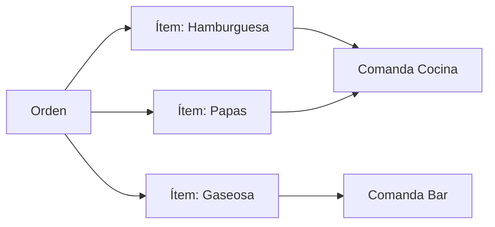

# 15 - Módulo Órdenes

**Estado:** Propuesto

Una **orden** es la solicitud de productos de un cliente, creada por cualquier canal. Es la entidad central de la operación. Estados en `16`, flujos en `17`, canales en `17A`.

## 1. Qué es una orden

Una orden pertenece a un restaurante y a una mesa (real o externa). Contiene **ítems de orden**, cada uno con producto, cantidad, modificadores y notas. Al enviarse, se divide en **comandas** según el punto de producción de cada producto (`19`).

## 2. Datos de una orden

| Campo | Descripción |
|---|---|
| Número | Consecutivo legible por restaurante y jornada (ej. `#042`), no es el ID interno |
| Canal | Tablet, QR de mesa, QR para llevar, WhatsApp, domicilio web, plataforma externa |
| Mesa | Mesa real o mesa externa |
| Zona | Zona de la mesa (o de la mesa externa) |
| Mesero | Responsable de la atención (si aplica) |
| Cliente | Opcional; obligatorio si es domicilio o para recoger |
| Sesión de mesa | Agrupa órdenes de la misma mesa (`10A`) |
| Cuenta | Cuenta a la que se cobra (`20`) |
| Ítems | Lista de ítems de orden |
| Notas generales | Texto libre |
| Datos de entrega | Dirección, teléfono, zona de envío (solo domicilio) |
| Cupón | Cupón aplicado, si lo hay |
| Clave de idempotencia | Evita duplicados en reintentos (RG-20) |
| Fechas | Creación, envío, cierre |
| Jornada operativa | A qué jornada pertenece (RG-09) |

## 3. Datos de un ítem de orden

| Campo | Descripción |
|---|---|
| Producto | Referencia al producto |
| **Nombre y precio copiados** | Instantánea al momento de crear (RG-13) |
| Cantidad | Entero positivo |
| Variante / tamaño | Si el producto las tiene |
| Modificadores | Adicionales, quitar ingredientes, punto de cocción |
| Nota del ítem | "Sin cebolla", "para llevar" |
| Punto de producción | Resuelto al crear el ítem (`19`) |
| Estado | Ver `16` (el estado vive en el ítem, ADR-006) |
| Precio del ítem | Con modificadores, sin impuesto o con impuesto según ADR-010 |

## 4. Creación de una orden

1. El canal envía los ítems con una **clave de idempotencia**.
2. El servidor valida: restaurante y zona activos, contrato con módulo `pedidos`, productos disponibles en la carta de la zona, horarios, cantidades.
3. Calcula precios desde el **servidor** (nunca confía en el precio que manda el cliente).
4. Guarda la orden y asigna número consecutivo de la jornada.
5. Si la zona exige **aprobación** (QR de mesa, `10A`), la orden queda **pendiente de aprobación** y no llega aún a producción.
6. Divide en comandas por punto de producción y las emite.
7. Emite eventos en tiempo real a tablet de zona, producción y caja.

Un reintento con la misma clave devuelve la orden original sin crear otra.

## 5. Edición de una orden ya enviada

Es una de las situaciones más delicadas de la operación. Reglas propuestas:

| Situación | Resultado |
|---|---|
| **Agregar ítems** a una orden enviada | Se crea una **comanda adicional**; la cocina ve que es una adición, no una orden nueva |
| **Quitar un ítem** en estado `nuevo` | Se cancela sin más trámite, con motivo |
| **Quitar un ítem** en estado `en_proceso` | Requiere permiso; avisa a producción; se registra como pérdida si ya se preparó (`16`) |
| **Quitar un ítem** ya `despachado` o `entregado` | Requiere permiso elevado y queda auditado |
| **Cambiar cantidad o modificadores** | Se trata como cancelar y agregar, con aviso en producción |
| **Cambiar de mesa** | Permitido con permiso; la producción ve la nueva mesa |

**Toda edición genera aviso visible en la pantalla de producción** (RG-21).

## 6. Cancelación y pérdida

| Concepto | Significado | Estado |
|---|---|---|
| **Cancelado** | Se anuló antes de producirse, o por decisión del cliente o del restaurante | `cancelado` (rojo) |
| **Perdido** | La orden o ítem no se puede cumplir o se produjo y no se entregó/cobró (ingrediente agotado, cliente se fue, error de cocina) | `cancelado` con motivo "pérdida" (rojo) |

Siempre se registra **motivo**, **usuario** y **momento** (RG-14). La pérdida se diferencia de la cancelación **por el motivo**, porque afecta inventario y reportes de forma distinta.

## 7. Orden y cuenta

- Una orden se cobra en una **cuenta** (`20`).
- Una cuenta puede agrupar **varias órdenes** de la misma mesa o sesión.
- Una orden **nunca** se borra (RG-12); solo se anula con motivo.

## 8. Reglas importantes (resumen)

Detalle en `36`.

- El precio siempre lo calcula el servidor.
- Una orden no sale a producción sin ítems válidos.
- No se puede crear una orden en una mesa o zona desactivada.
- Una orden de QR sin aprobación no llega a producción.
- Toda modificación posterior al envío se audita.

## 9. Preguntas abiertas

- ¿Los modificadores pueden cambiar el precio? (Recomiendo sí, con precio configurable por opción.)
- ¿Existe límite de ítems por orden o de valor máximo para órdenes por QR sin aprobación?
- ¿Hay propina sugerida en la orden o solo al cobrar? (Recomiendo al cobrar, `20`.)
- ¿La numeración reinicia por jornada o es continua?
