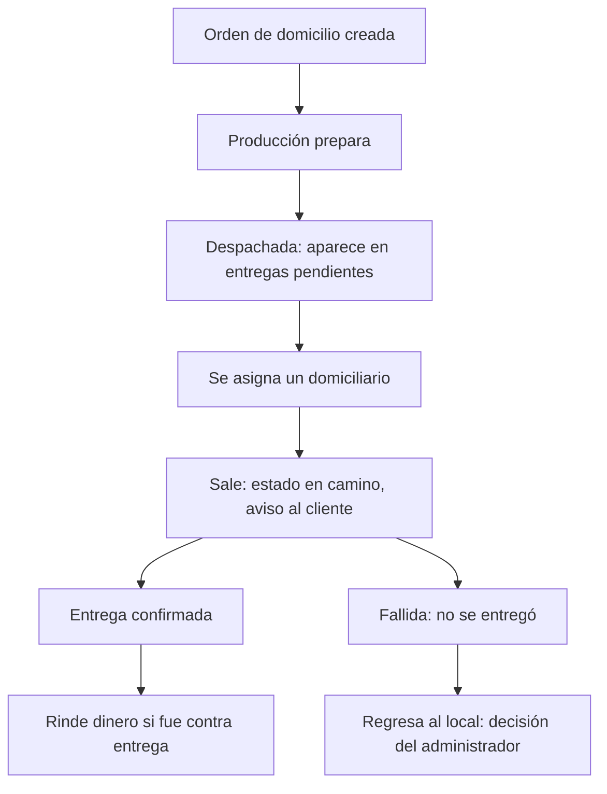

# 15B - Domicilios

**Estado:** Propuesto

Gestiona las entregas a domicilio hechas con **domiciliarios propios** del restaurante: zonas de envío, tarifas, asignación, seguimiento y liquidación. Las entregas de plataformas (Rappi, Uber Eats) las hacen sus propios repartidores y se tratan en `31A`.

## 1. Zonas de envío y tarifas

Una **zona de envío** es un área de cobertura con una tarifa. Se puede definir por:

| Método | Descripción | Complejidad |
|---|---|---|
| **Lista de barrios o sectores** | El administrador crea zonas por nombre ("Centro", "Norte") y el cliente o el encargado la elige | Baja (recomendada para el MVP) |
| **Radio desde el local** | Tarifa por distancia en kilómetros | Media; requiere geolocalización |
| **Polígonos en mapa** | Áreas dibujadas sobre un mapa | Alta; depende de servicios de mapas |

**Recomendación:** empezar con **lista de zonas con tarifa fija**. Los mapas y la geolocalización traen costos y complejidad que no hacen falta para validar. `[POR CONFIRMAR]`

| Campo de zona de envío | Descripción |
|---|---|
| Nombre | "Centro", "Norte" |
| Tarifa | Valor cobrado al cliente |
| Pago al domiciliario | Valor que se le reconoce (puede ser distinto de la tarifa) |
| Pedido mínimo | Opcional |
| Estado | Activa o inactiva |

## 2. Domiciliarios

Cada domiciliario tiene:

| Campo | Descripción |
|---|---|
| Nombre, documento y teléfono | Datos básicos |
| **Código** | Identificador para registrar sus entregas (cumple "domiciliarios codificados") |
| Tipo de vínculo | Propio del restaurante o independiente (informativo; ver advertencia en `26A`) |
| Estado | `activo`, `inactivo`, `en entrega` |
| Usuario en el sistema | Opcional (fase 2, vista móvil) |

## 3. Flujo de una entrega

1. Producción despacha la orden.
2. Aparece en la lista de **entregas pendientes**.
3. El encargado **asigna un domiciliario** por su código (o el domiciliario la toma).
4. Se marca **en camino**; el cliente recibe aviso de que salió (`31B`, fase 2).
5. Al entregar se marca **entregada** (`entregado` en `16`).
6. Si fue contra entrega, el domiciliario **rinde el dinero** en caja (`20`).

## 4. Estados de la entrega

| Estado | Significado |
|---|---|
| `pendiente_asignacion` | Despachada, sin domiciliario |
| `asignada` | Con domiciliario, aún en el local |
| `en_camino` | Salió del local |
| `entregada` | El cliente la recibió |
| `fallida` | No se pudo entregar (cliente ausente, dirección errónea) |

La entrega es una entidad **ligada a la orden**; no sustituye los estados de la orden.

## 5. Cobro del domicilio

- La tarifa de envío se **agrega a la cuenta** como concepto aparte, con sus impuestos si aplica (`21`, `21A`).
- Para **recoger en el local** no se cobra envío (`RN-ORD-13`).
- Un cupón puede dar **envío gratis** (`25A`).

## 6. Efectivo contra entrega

El dinero que cobra el domiciliario es un riesgo operativo clásico. El sistema debe:

- Registrar el **monto a cobrar** por entrega.
- Mostrar al cajero **cuánto debe rendir** cada domiciliario.
- Registrar la **rendición** (qué entregó, qué diferencia hubo).
- Dejar todo ligado al turno de caja (`20`).

## 7. Liquidación al domiciliario

El pago por servicio se calcula con las entregas realizadas y el pago configurado por zona; ver `26A`.

## 8. Reglas

- **RN-DOM-01.** Una entrega siempre tiene dirección, teléfono y zona de envío.
- **RN-DOM-02.** Un domiciliario no puede tener entregas `en_camino` cuando se desactiva.
- **RN-DOM-03.** Toda rendición de efectivo se registra con usuario y diferencia.
- **RN-DOM-04.** Una entrega fallida requiere motivo y decisión (reintento, cancelación, pérdida).
- **RN-DOM-05.** Cada entrega guarda hora de salida y de entrega para métricas.

## 9. Preguntas abiertas

- ¿Un domiciliario lleva varias órdenes en una misma salida?
- ¿Se necesita seguimiento en mapa para el cliente? (Fuera del MVP.)
- ¿Cómo se manejan las propinas del cliente al domiciliario?
