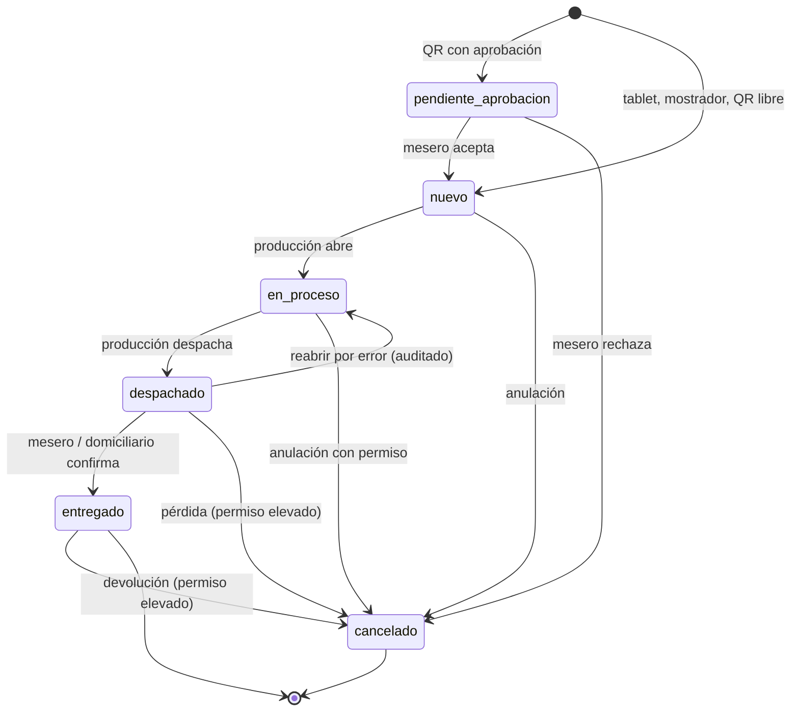

# 16 - Estados de las Órdenes

**Estado:** Propuesto

Define los estados, sus colores y las transiciones permitidas. Es la **única fuente de verdad** sobre estados (RG-22 y RG-24). Decisión de fondo en ADR-006 (`37`).

## 1. Principio

El estado vive en el **ítem** (cada ítem de comanda). El estado de la **orden** se **deriva** de los estados de sus ítems. Así una orden con un plato listo y una bebida en proceso se representa con exactitud.

## 2. Estados de un ítem

| Estado | Color | Significado | Quién lo cambia |
|---|---|---|---|
| `pendiente_aprobacion` | Gris | Orden de QR esperando que el mesero la acepte (`10A`) | Mesero (acepta o rechaza) |
| `nuevo` | **Azul claro** | Enviado a producción, aún no abierto | Sistema (al enviar) |
| `en_proceso` | **Amarillo** | Producción abrió la comanda y la está preparando | Cocina / bar |
| `despachado` | Verde claro | Producción terminó y lo entregó al mesero o al domiciliario; aparece en **Listos** | Cocina / bar |
| `entregado` | **Verde** | El cliente ya lo recibió | Mesero, cajero o domiciliario |
| `cancelado` | **Rojo** | Anulado o perdido, con motivo | Usuario con permiso |

> **[POR CONFIRMAR]** Tus cuatro colores originales eran azul claro, amarillo, verde y rojo. `pendiente_aprobacion` y `despachado` son estados que agrego para cubrir dos situaciones que tu descripción menciona de forma implícita: la aprobación de órdenes de QR y la pestaña "Listos" de cocina. Si prefieres solo cuatro estados, `despachado` se puede fusionar con `entregado`, a costa de perder el tiempo de espera entre cocina y mesa.

## 3. Transiciones permitidas

Cualquier transición **fuera** de este diagrama se rechaza (RG-22).

### Quién puede qué (resumen; matriz completa en `29`)

| Transición | Rol mínimo |
|---|---|
| Aceptar o rechazar orden de QR | Mesero de la zona |
| `nuevo` → `en_proceso` | Cocina / bar |
| `en_proceso` → `despachado` | Cocina / bar |
| `despachado` → `entregado` | Mesero, cajero, domiciliario |
| Cancelar en `nuevo` | Mesero, cajero, administrador |
| Cancelar en `en_proceso` o posterior | Administrador o rol con permiso específico |
| Reabrir (`despachado` → `en_proceso`) | Cocina / bar, con registro |

## 4. Estado derivado de la orden

Se calcula con los ítems **no cancelados**:

| Condición | Estado de la orden | Color |
|---|---|---|
| Todos los ítems cancelados | `cancelada` | Rojo |
| Todos los ítems no cancelados en `entregado` | `entregada` | Verde |
| Todos en `despachado` o `entregado` | `lista` | Verde claro |
| Alguno en `en_proceso`, o mezcla de estados avanzados | `en_proceso` | Amarillo |
| Todos en `nuevo` | `nueva` | Azul claro |
| Todos en `pendiente_aprobacion` | `pendiente_aprobacion` | Gris |

**Ejemplo:** pizza `despachado` + cerveza `nuevo` → la orden está `en_proceso` (amarillo) porque aún hay trabajo pendiente.

## 5. Historial de estados

Cada cambio guarda: ítem, estado anterior, estado nuevo, **usuario**, **dispositivo**, **momento** y **motivo** (obligatorio al cancelar o reabrir). Alimenta:

- Tiempos de preparación y de entrega (reportes, `26`).
- Auditoría (`30`).
- Resolución de disputas ("¿cuándo se despachó?").

## 6. Avisos

| Evento | A quién avisa |
|---|---|
| Orden nueva | Producción destino; tablet de la zona |
| Orden de QR pendiente de aprobación | Tablet de la zona (aviso destacado) |
| Ítem despachado | Mesero de la mesa y tablet de la zona |
| Ítem agregado, quitado o cancelado tras enviar | Producción afectada |
| Orden lista para recoger o salió a domicilio | Cliente (WhatsApp, fase 2) |

## 7. Alertas de tiempo (opcional en MVP)

Cada punto de producción puede definir tiempos objetivo. Una comanda que supera el tiempo cambia visualmente (parpadeo, borde, contador) sin cambiar de estado. **Los colores de estado no se reutilizan para alertas de tiempo** (principio 6 de `00A`); se usa un indicador distinto.

## 8. Preguntas abiertas

- ¿Se permite pasar de `nuevo` a `despachado` sin pasar por `en_proceso` (bebidas simples)? Recomiendo configurarlo **por punto de producción**.
- ¿Quién confirma `entregado` en pedidos para llevar y domicilios? (Cajero o domiciliario.)
- ¿Una orden `lista` que lleva demasiado tiempo sin entregarse debe alertar?
