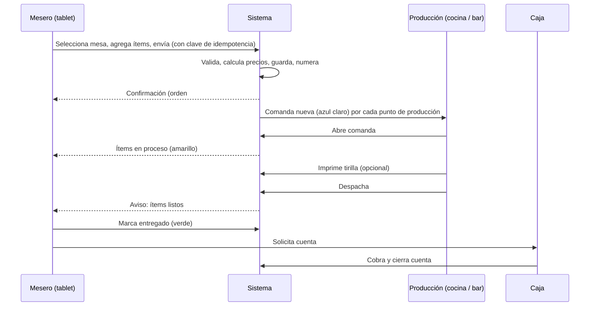
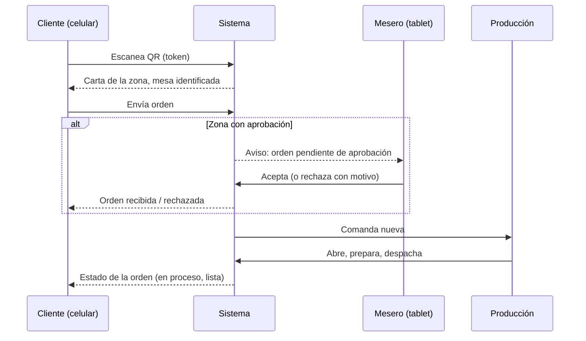
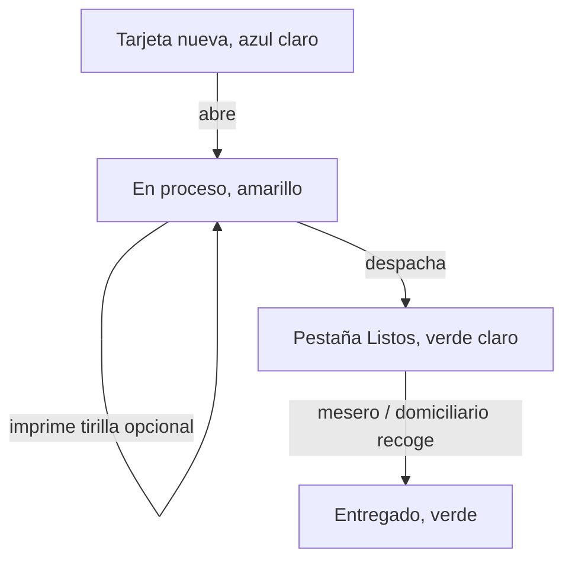

# 17 - Flujo de Órdenes

**Estado:** Propuesto

Describe el recorrido de una orden de principio a fin, paso a paso, incluyendo lo que ocurre cuando algo sale mal. Estados en `16`; detalle por canal en `17A`.

## 1. Flujo A: mesero toma la orden en la tablet de zona

### Pasos

1. El mesero ve **solo las mesas de su zona** en la tablet.
2. Selecciona una mesa, agrega productos de la carta de esa zona, notas y modificadores.
3. Envía la orden. La tablet muestra confirmación solo cuando el servidor la **guardó**.
4. La orden se divide en comandas por punto de producción.
5. Producción trabaja la comanda (flujo en `18`).
6. El mesero recibe el aviso de **ítems despachados** y los entrega.
7. El mesero marca `entregado`.
8. La cuenta se cobra en caja (`20`).

## 2. Flujo B: cliente pide por QR de mesa

### Diferencias respecto al flujo A

- El **contexto** (empresa, restaurante, zona, mesa) viene del token del QR (`10A`).
- Según el modo de la zona, la orden va **directo a producción** o **espera aprobación**.
- El cliente ve el **estado** de su orden en su celular (sin necesidad de registrarse).
- La orden se asocia a la **sesión de mesa**, que agrupa lo que pidan todos los de la mesa.

## 3. Flujo C: orden externa (mostrador, WhatsApp, domicilio, para llevar)

1. La orden se registra en la **mesa externa** del restaurante.
2. Se captura la información del cliente según el canal (`17A`).
3. Sigue el mismo flujo de producción.
4. Al despachar, **no hay mesero de mesa**: la entrega la hace el cajero (para recoger) o el domiciliario (domicilio).
5. Se cobra: contra entrega, pago en línea (fase 2) o en el mostrador.

## 4. Flujo en producción

Detalle de la pantalla en `18`.

## 5. Flujo de cobro (resumen)

1. El mesero o cajero solicita la cuenta de la mesa o sesión.
2. Caja une todas las órdenes no canceladas de la sesión en una **cuenta**.
3. Aplica cupón, propina, domicilio e impuestos.
4. Se registra el pago.
5. Se imprime la tirilla final y se genera la factura (fase 2).
6. La sesión de mesa se cierra.

Detalle en `20` y `21`.

## 6. Casos excepcionales

| Situación | Qué hace el sistema |
|---|---|
| **Se cae internet en la tablet al enviar** | No muestra "enviado". Avisa que no hay conexión y mantiene la orden como borrador local. Al reconectar, el mesero la reenvía; la clave de idempotencia evita duplicados |
| **Se envía dos veces por doble toque** | La misma clave devuelve la misma orden |
| **Producción no confirma recepción** | La comanda queda marcada "sin confirmar" en la tablet del mesero después de un tiempo definido |
| **Producto se agota con órdenes en curso** | Producción marca ítem como agotado; el mesero recibe aviso para ofrecer alternativa; el ítem se cancela con motivo |
| **Cliente cambia de idea** | Ver reglas de edición en `15`, sección 5 |
| **Mesero se va del turno con órdenes abiertas** | El administrador reasigna las mesas; queda auditado |
| **Cliente de QR pide y se va** | La orden queda en la cuenta; el mesero la cierra o la marca como pérdida con motivo |
| **Impresora sin papel o desconectada** | La tirilla queda en cola y se avisa en producción (`19A`) |
| **Una cocina cae pero el bar sigue** | Cada punto de producción opera de forma independiente |

## 7. Qué debe estar probado antes de producción

- Envío duplicado.
- Orden con ítems de varios puntos de producción.
- Edición después de enviar.
- Orden de QR con y sin aprobación.
- Reconexión de tablet y cocina en mitad de una orden.
- Dos meseros agregando ítems a la misma mesa a la vez.
