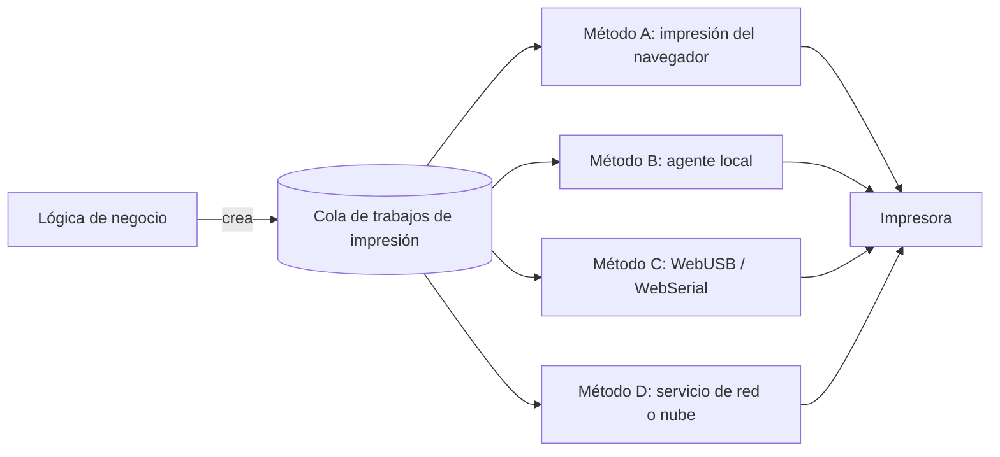

# 19A - Impresión y Tirillas

**Estado:** Propuesto (la estrategia técnica final está **Pendiente**, ADR-005)

Imprimir desde una aplicación 100% web es de los puntos que más suelen salir mal en proyectos como este, porque depende del hardware real del restaurante. Este documento define **qué se imprime, con qué contenido y cómo se diseña el sistema para no quedar atado a un solo método**, y deja claro qué **no** sé todavía.

## 1. Qué se imprime

| Documento | Cuándo | Dónde | Contiene precios |
|---|---|---|---|
| **Tirilla de comanda** | Al abrir o bajo demanda | Impresora del punto de producción | No |
| **Tirilla de cuenta** (precuenta) | Al solicitar la cuenta | Caja | Sí |
| **Tirilla de pago / comprobante** | Al cobrar | Caja | Sí |
| **Factura** | Fase 2, con facturación electrónica | Caja o envío digital | Sí |
| **Cierre de turno de caja** | Al cerrar | Caja | Sí |
| **Informe diario por mesero** | Al cierre de jornada | Administración | Sí |

## 2. Contenido de la tirilla de comanda

```
================================
 COCINA              #042
 Mesa 5 - Zona Rápidas
 Canal: QR      Mesero: Laura
 24/10/2026   21:42
--------------------------------
 2 x Hamburguesa
     - sin cebolla
     + queso extra
 1 x Papas
     ** ALERGIA: maní **
--------------------------------
 ADICIÓN a orden anterior
================================
```

Obligatorio: número de orden, punto de producción, canal, mesa o nombre del cliente externo, zona, hora, ítems con cantidad, modificadores y notas. Para órdenes externas: **PARA LLEVAR** o **DOMICILIO** destacado y teléfono (la dirección completa solo en la tirilla de entrega). Marca de **REIMPRESIÓN** cuando corresponda.

## 3. Contenido de la tirilla de cuenta

Nombre y datos del restaurante, número de orden o cuenta, mesa o cliente, ítems con precio, subtotales, impuestos, descuentos o cupones, domicilio, propina sugerida o cobrada, total, medio de pago, mensaje configurable. Una tirilla de cuenta **no es una factura** salvo que cumpla los requisitos legales (`21A`).

## 4. Diseño recomendado: cola de impresión independiente del método

La lógica de negocio **no habla con impresoras**. Solo crea un **trabajo de impresión**.



Cada trabajo guarda: tipo de documento, contenido, punto de producción o caja destino, impresora, estado (`pendiente`, `impreso`, `fallido`), intentos y quién lo originó.

**Ventajas:** se puede cambiar o combinar el método sin tocar órdenes ni caja; se pueden reintentar trabajos fallidos; hay historial de qué se imprimió y cuándo.

## 5. Opciones técnicas (resumen de `04`)

| Método | Estado en este proyecto |
|---|---|
| A. Impresión del navegador | **Candidato para el corte vertical** |
| B. Agente local con ESC/POS | Candidato principal para producción si A es insuficiente |
| C. WebUSB / WebSerial | Dependiente de navegador y sistema operativo; evaluar con las tablets reales |
| D. Servicio de red o nube | Dependiente de la marca y modelo de impresora |

> **Lo que no puedo afirmar:** qué método funcionará mejor en las impresoras y tablets de **tus** clientes. Eso depende de modelos concretos, del sistema operativo de las tablets y de la red del local. Por eso es una **decisión pendiente basada en pruebas** (sección 8).

## 6. Formato físico

- Ancho típico de papel térmico: **58 mm o 80 mm**; hay que soportar ambos configurables por impresora.
- Fuente monoespaciada, texto grande para notas y modificadores.
- Corte automático si la impresora lo soporta.
- Caracteres en español (tildes, ñ) correctamente codificados; hay que probarlo con cada modelo.

## 7. Reglas

- Una **reimpresión** siempre se marca visiblemente y se registra con usuario y motivo (RG-14).
- Un trabajo fallido **no se pierde**: queda en cola y se muestra en la pantalla de producción o de caja.
- La impresión **nunca bloquea** la operación: si no hay impresora, la comanda sigue visible en pantalla.
- Una impresora puede estar vinculada a varios puntos de producción.
- Las tirillas de comanda **no** muestran precios.

## 8. Plan de pruebas con hardware real (necesario antes de decidir ADR-005)

Lista de verificación para el corte vertical:

1. Identificar 2 o 3 modelos de impresora térmica comunes entre los restaurantes entrevistados.
2. Probar cada método (A, B, C, D) con cada modelo desde las tablets reales.
3. Medir: tiempo desde "despachar" hasta tirilla, necesidad de diálogos del navegador, corte, tildes, comportamiento con papel agotado o desconexión.
4. Probar con red Wi-Fi del local, no solo con la del desarrollador.
5. Probar impresión simultánea de cocina y bar.
6. Documentar resultados y cerrar ADR-005.

## 9. Preguntas abiertas

- ¿Cada punto de producción tendrá su propia impresora? (Probablemente sí en bar y cocina.)
- ¿La tirilla de cocina se imprime siempre o solo cuando el cocinero lo pide?
- ¿Se imprime una copia para el mesero?
- ¿Qué pasa si el restaurante no tiene impresora térmica? (Debe poder operar solo con pantalla.)
