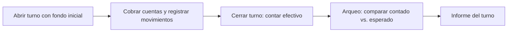

# 20 - Módulo Caja

**Estado:** Propuesto

La **caja** controla el dinero que entra y sale del restaurante: cobros, turnos, arqueos y cierres. Incluye un **POS de mostrador** que permite vender sin el módulo de pedidos (ADR-007). Facturación en `21`; pagos en línea en `20A`.

## 1. Conceptos

| Concepto | Descripción |
|---|---|
| **Caja** | Punto de cobro físico o lógico (caja principal, caja de barra) |
| **Turno de caja** | Periodo en que un cajero responde por una caja |
| **Cuenta** | Lo que se cobra; agrupa las órdenes de una sesión de mesa o una venta de mostrador |
| **Pago** | Dinero que cubre total o parte de una cuenta |
| **Medio de pago** | Efectivo, tarjeta, transferencia, pago en línea, otros |
| **Movimiento de caja** | Entrada o salida que no es venta (gasto, retiro, fondo) |

## 2. Turno de caja

- **Apertura:** el cajero declara el **fondo inicial** de efectivo.
- **Durante el turno:** cobros, retiros parciales, gastos menores, rendiciones de domiciliarios.
- **Cierre:** el cajero declara el efectivo contado y el sistema calcula la diferencia con lo esperado.
- **Informe del turno:** ventas por medio de pago, descuentos, anulaciones, diferencia de arqueo.

Toda operación de cobro requiere un **turno abierto** (`RN-CAJ-01`).

## 3. Cobro de una cuenta

1. Se solicita la cuenta de la mesa o sesión (o se crea una venta de mostrador).
2. Caja une las órdenes **no canceladas** en una cuenta.
3. Se aplican **cupón**, **descuento** (con permiso), **domicilio** e **impuestos**.
4. Se ofrece o registra la **propina** (`26A`).
5. Se registra uno o varios **pagos** hasta cubrir el total.
6. Se imprime el **comprobante** y, en fase 2, se genera la **factura** (`21`).
7. Se cierra la sesión de la mesa.

## 4. Pagos mixtos y división de cuenta

| Situación | Tratamiento |
|---|---|
| **Pago mixto** (parte efectivo, parte tarjeta) | Varios pagos sobre la misma cuenta |
| **Dividir en partes iguales** | La cuenta se reparte en N pagos |
| **Dividir por ítems** | Cada comensal paga lo suyo |
| **Pagar una parte y dejar el resto abierto** | La cuenta queda con saldo |

La división de cuenta es **muy frecuente** en restaurantes y suele ser donde un POS flaquea; debe ser rápida y probada con casos reales.

## 5. Propina al cobrar

La propina se registra como **concepto separado** del valor de la venta (`21`, `26A`). Opciones: valor sugerido configurable, valor libre, sin propina. La propina cobrada con tarjeta se registra con su medio de pago, para su liquidación posterior.

## 6. Descuentos, anulaciones y correcciones

| Acción | Permiso | Registro |
|---|---|---|
| Aplicar cupón | Cajero | Cupón y cuenta |
| Descuento manual | Administrador o permiso específico | Motivo, usuario, monto |
| Anular una cuenta ya cobrada | Administrador | Motivo, usuario; documento de ajuste si hay factura |
| Devolución parcial | Administrador | Motivo, ítems, forma de reintegro |

Todo se audita (RG-14).

## 7. Movimientos de caja

- **Gastos menores** (compra de hielo, domicilio de insumos), con comprobante y categoría.
- **Retiros** parciales para reducir efectivo en caja.
- **Aportes** o fondos adicionales.
- **Rendición de domiciliarios** (`15B`).

## 8. Cierre de jornada

El administrador **cierra la jornada operativa**, lo que:

1. Verifica que no haya turnos ni cuentas abiertas sin resolver.
2. Congela los totales de la jornada.
3. Genera el **informe diario** del restaurante y por mesero (`08A`, `26`).

## 9. POS de mostrador (sin pedidos)

Para el paquete "solo gestión" (ADR-007). **Implementado en la fase 2 (ADR-039):** pestaña "Venta directa" de caja.

- Venta directa: elegir productos, cobrar, imprimir comprobante.
- Sin mesas, sin cocina ni comandas.
- Alimenta facturación, inventario y reportes igual que una venta con pedidos.

## 10. Cuentas por cobrar (fiado)

Común en negocios pequeños. **Fase 2.** Una cuenta puede quedar a crédito a nombre de un cliente registrado, con saldo y abonos. Requiere definir límites, cobro y manejo contable.

## 11. Reglas

- **RN-CAJ-01.** No se registra un cobro sin turno de caja abierto.
- **RN-CAJ-02.** Un cajero solo tiene un turno abierto a la vez por caja.
- **RN-CAJ-03.** Un turno no se cierra con cuentas parcialmente pagadas sin decisión explícita.
- **RN-CAJ-04.** La suma de pagos de una cuenta no puede exceder el total más la propina.
- **RN-CAJ-05.** Un pago registrado no se edita; se corrige con un movimiento compensatorio (RG-12).
- **RN-CAJ-06.** La diferencia de arqueo se registra siempre, con o sin motivo.
- **RN-CAJ-07.** Una jornada cerrada no admite nuevos cobros en esa jornada.

## 12. Preguntas abiertas

- ¿El mesero puede cobrar en la mesa con un datáfono o solo caja cobra?
- ¿Se manejan varias cajas en un mismo restaurante en el MVP? (Recomiendo una, preparado para varias.)
- ¿Cómo se registran propinas dadas en efectivo directamente al mesero?
