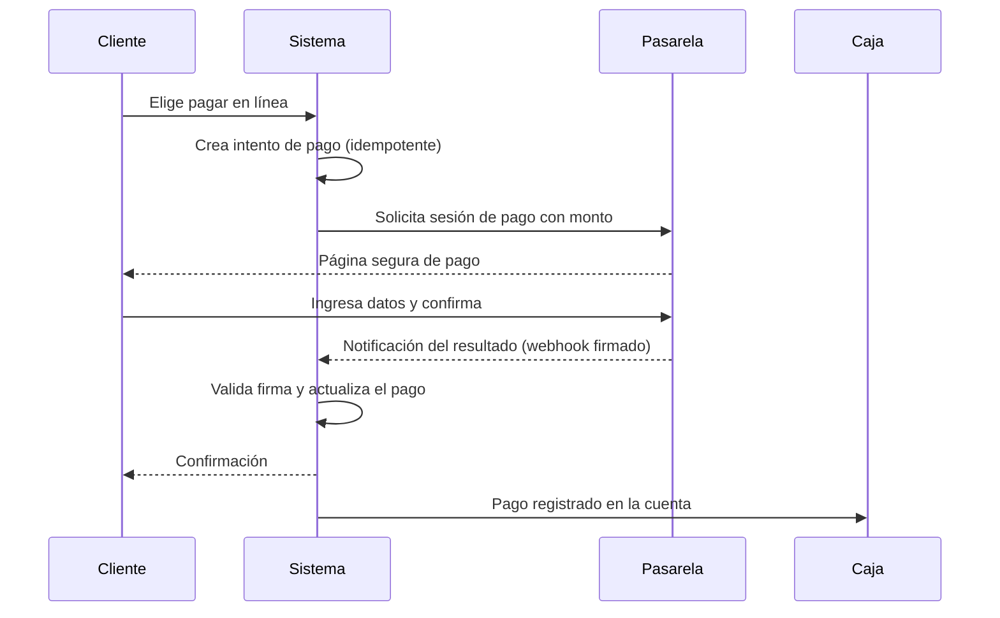

# 20A - Pagos en Línea

**Estado:** Propuesto (fase 2)

Permite que el cliente **pague desde su celular** después de pedir: desde la mesa, para llevar o a domicilio. Se apoya en una **pasarela de pagos** externa. El sistema **nunca** guarda datos de tarjeta (RG-19).

## 1. Alcance

| Escenario | Descripción |
|---|---|
| Pagar la cuenta de la mesa desde el celular | Después de pedir por QR |
| Pagar una orden para llevar al hacer el pedido | Antes de pasar a producción |
| Pagar un domicilio al hacer el pedido | Evita efectivo contra entrega |
| Propina en línea | Agregada al pago |

## 2. Flujo general

La **fuente de verdad** del resultado es la **notificación de la pasarela** (webhook firmado), no lo que reporta el navegador del cliente.

## 3. Estados del pago

| Estado | Significado |
|---|---|
| `pendiente` | Intento creado, sin resultado |
| `aprobado` | La pasarela confirmó |
| `rechazado` | La pasarela lo rechazó |
| `expirado` | No se completó en el tiempo permitido |
| `reembolsado` / `parcial` | Devolución total o parcial |

## 4. Reglas de negocio importantes

- **Idempotencia:** un mismo intento no puede cobrar dos veces ni aplicarse dos veces a la cuenta.
- **Webhook repetido o fuera de orden:** debe procesarse de forma segura.
- **Pago aprobado sobre una cuenta ya modificada:** hay que definir qué ocurre si cambió el total mientras el cliente pagaba. Recomendación: **congelar** el monto del intento y reconciliar la diferencia en caja.
- **Pago aprobado sin respuesta al cliente** (se cerró la pantalla): el sistema igualmente lo registra al recibir el webhook.
- **Reembolsos:** solo con permiso, con motivo, y a través de la pasarela.

## 5. Conciliación

El administrador debe poder **conciliar**: pagos aprobados en el sistema contra los reportes de la pasarela. Se registra:

- Monto bruto, **comisión de la pasarela** y monto neto cuando esté disponible.
- Fecha de abono al restaurante.
- Diferencias.

## 6. Elegir pasarela

Criterios:

| Criterio | Qué revisar |
|---|---|
| Cobertura de medios | Tarjetas, transferencias, billeteras del mercado objetivo |
| Comisiones | **No las asumo**: verificar tarifas vigentes con cada proveedor |
| Contrato para el restaurante | ¿Cada restaurante necesita su propia cuenta con la pasarela? ¿O el proveedor del software recauda? |
| API y webhooks | Calidad, documentación, ambiente de pruebas |
| Reembolsos y conciliación | Facilidad |
| Requisitos legales | Cuenta comercial, aprobación de riesgo |

> **Pregunta de fondo:** si cada restaurante abre **su propia cuenta** en la pasarela, el proveedor del software solo integra y **no maneja dinero de terceros** (menos riesgo regulatorio). Si el proveedor **recauda y reparte**, asume obligaciones financieras y legales mucho mayores. Recomiendo lo primero. `[POR CONFIRMAR]` con un asesor legal.

Ejemplos de pasarelas que existen en el mercado colombiano y que conviene evaluar: Wompi, PayU, ePayco, Mercado Pago. **Verificar** disponibilidad, comisiones y condiciones antes de decidir (ADR pendiente).

## 7. Seguridad

- Los datos de tarjeta se ingresan **solo en la página de la pasarela**.
- Webhooks con **firma verificada** y lista blanca de origen si la pasarela la ofrece.
- Credenciales de cada restaurante guardadas **cifradas**.
- Registro de cada intento y notificación en auditoría.

## 8. Reglas

- **RN-PAG-01.** Un pago en línea solo se considera aprobado tras validar la notificación firmada de la pasarela.
- **RN-PAG-02.** Un intento tiene monto fijo y no se reutiliza para otra cuenta.
- **RN-PAG-03.** Un reembolso requiere permiso y deja huella en caja y auditoría.
- **RN-PAG-04.** Si falla la comunicación con la pasarela, el cliente puede pagar en caja; el sistema nunca bloquea la operación.

## 9. Preguntas abiertas

- ¿Quién asume la comisión: restaurante o cliente?
- ¿Se permite pagar solo una parte de la cuenta en línea?
- ¿Cómo se maneja la propina cuando el pago es en línea?
