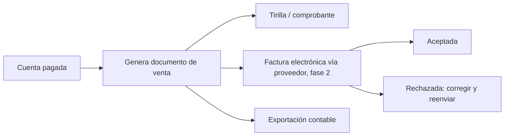

# 21 - Módulo Facturación

**Estado:** Propuesto

Gestiona los **documentos de venta** que se entregan al cliente y que respaldan la contabilidad. La parte legal (impuestos, facturación electrónica, proveedor tecnológico) está en `21A`.

> **Advertencia:** esto no es asesoría legal ni contable. Lo que debe emitir un restaurante, con qué formato y qué numeración depende de su régimen y de la normativa local. **Debe validarse con un contador** antes de lanzar. `[POR CONFIRMAR]`

## 1. Tipos de documento

| Documento | Naturaleza | Fase |
|---|---|---|
| **Tirilla de cuenta (precuenta)** | Informativa, no fiscal | MVP |
| **Comprobante de pago interno** | Registro interno, **no fiscal** | MVP |
| **Factura electrónica / documento equivalente** | Fiscal, vía proveedor tecnológico | Fase 2 |
| **Nota crédito / ajuste** | Corrige o anula un documento fiscal | Fase 2 |

> **Riesgo del MVP:** si el restaurante **está obligado** a facturar electrónicamente, un comprobante interno **no lo cubre**. El MVP solo es viable para quien ya emite facturas con otro sistema, o para quien no esté obligado. Verificar con los primeros clientes (`38`).

## 2. Qué incluye un documento de venta

| Bloque | Contenido |
|---|---|
| Emisor | Datos del restaurante |
| Cliente | Consumidor final o cliente identificado (nombre y documento si lo pide) |
| Ítems | Producto, cantidad, valor unitario, impuesto |
| Conceptos adicionales | Domicilio, descuento, cupón |
| Impuestos | Desglose por tipo y base |
| Totales | Subtotal, impuestos, descuentos, total |
| **Propina** | Concepto **separado** del valor de la venta (ver abajo) |
| Pago | Medios y valores |
| Numeración | Según resolución o configuración |
| Origen | Orden(es), mesa, canal |

### Propina fuera de la base de la factura

Las propinas generalmente **no hacen parte del valor gravado de la venta**. Deben manejarse como concepto aparte. La regla exacta depende de la normativa local, **por verificar con el contador** (`26A`).

## 3. Flujo

## 4. Estados de un documento fiscal (fase 2)

| Estado | Significado |
|---|---|
| `borrador` | Aún editable |
| `emitida` | Enviada al proveedor tecnológico |
| `aceptada` | Validada por la autoridad fiscal |
| `rechazada` | Con errores; se corrige y se reenvía |
| `anulada` | Anulada con documento de ajuste |

Una factura **emitida no se modifica** (RG-07); se corrige con nota.

## 5. Numeración

- Rangos y prefijos configurables por restaurante y por caja.
- Sin saltos ni duplicados: la asignación debe ser **atómica**.
- Alertas cuando el rango autorizado se está agotando.

## 6. Contingencias

| Falla | Qué hace el sistema |
|---|---|
| El proveedor no responde | La venta **no se bloquea**; el documento queda en cola de emisión con reintentos |
| La emisión es rechazada | Alerta al administrador; corrección guiada |
| Se cae internet | Se vende normalmente; la emisión se realiza al reconectar (según permita la normativa; **verificar**) |

## 7. Exportación y contabilidad

- Informe de ventas por impuesto y medio de pago por periodo.
- **Exportación** a formatos de software contable (fase 3).
- Cierre diario con totales para el contador.

## 8. Reglas

- **RN-FAC-01.** Los valores de un documento salen de la cuenta pagada; no se digitan de nuevo.
- **RN-FAC-02.** Un documento emitido no se edita ni se elimina (RG-07).
- **RN-FAC-03.** La propina nunca se suma a la base gravable por defecto.
- **RN-FAC-04.** Toda anulación genera documento de ajuste con motivo y usuario.
- **RN-FAC-05.** La numeración no se reutiliza ni se salta.
- **RN-FAC-06.** La falla del proveedor de facturación nunca impide cobrar.

## 9. Preguntas abiertas

- ¿Precio con o sin impuesto incluido? Pendiente en ADR-010.
- ¿El cliente puede pedir factura a su nombre después del pago? (Recomiendo sí, con ventana de tiempo.)
- ¿Qué obligaciones tienen los restaurantes de tu público objetivo? Verificar con contador y primeros clientes.
