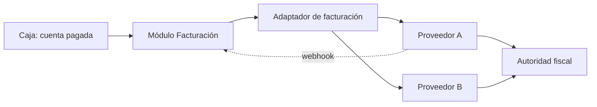

# 21A - Impuestos y Facturación Electrónica

**Estado:** Propuesto (fase 2). **Requiere validación legal y contable.**

Contiene la parte regulada del módulo de facturación. Está separada de `21` para poder **cambiar de proveedor o de normativa sin tocar el resto del sistema**.

> **Aviso importante:** asumo Colombia como mercado inicial (`[POR CONFIRMAR]`). Las normas fiscales cambian con frecuencia. **No debes construir basándote en mi resumen.** Todo lo de este documento debe verificarse con un contador colombiano y con la documentación vigente de la DIAN y del proveedor tecnológico que elijas.

## 1. Qué hay que resolver

| Tema | Pregunta |
|---|---|
| **Obligación** | ¿Qué documentos debe emitir cada tipo de cliente (régimen, tamaño, actividad)? |
| **Proveedor** | ¿Se integra un proveedor tecnológico autorizado o se hace integración directa? |
| **Documento** | ¿Factura electrónica, documento equivalente electrónico de punto de venta, u otro? |
| **Numeración** | ¿Qué resoluciones y rangos aplican por restaurante y caja? |
| **Impuestos** | ¿Qué impuestos aplican y sobre qué base? |
| **Propina** | ¿Cómo se trata fiscalmente y cómo se muestra? |

## 2. Impuestos (modelo, sin valores)

El sistema no debe tener tasas escritas en el código (RG-06). Se modelan:

| Concepto | Descripción |
|---|---|
| **Tipo de impuesto** | IVA, impuesto al consumo u otros que correspondan |
| **Tasa** | Porcentaje configurable |
| **Vigencia** | Fecha de inicio y fin |
| **Aplicación** | Por producto o categoría; puede haber productos exentos o excluidos |
| **Base** | Cómo se calcula (precio sin impuesto o con impuesto incluido; ADR-010) |

**Pregunta de fondo:** en restauración suelen aplicar reglas específicas según el régimen del establecimiento. No asumas qué impuesto aplica a tus clientes; **pregúntalo al contador**.

## 3. Proveedor tecnológico vs. integración directa

| Opción | Pros | Contras |
|---|---|---|
| **Proveedor tecnológico (API)** | Cumplimiento delegado, menos riesgo, más rápido | Costo por documento o suscripción; dependencia |
| **Integración directa con la autoridad** | Sin intermediario | Requiere habilitación propia, certificaciones y mantenimiento constante |

**Recomendación:** **proveedor tecnológico** (ADR-011: adaptador). Para un equipo pequeño, hacerlo directamente es casi siempre mala idea.

Hay proveedores y plataformas contables con API que existen en el mercado (por ejemplo Siigo, Alegra, Factus, entre otros). **Verificar** que tengan API de emisión, costo por documento, soporte para restaurantes y modo multi-emisor (cada restaurante con su propia razón social).

### Preguntas para el proveedor candidato

1. ¿Soportan varios emisores (un cliente por restaurante) bajo mi cuenta?
2. ¿Cómo cobran: por documento, por suscripción, por emisor?
3. ¿Manejan documento equivalente de POS o factura, según el caso?
4. ¿Hay ambiente de pruebas y webhooks de estado?
5. ¿Qué pasa si su servicio se cae? ¿Hay contingencia?
6. ¿Cómo se maneja la numeración y las resoluciones?
7. ¿Soportan notas crédito y anulaciones?

## 4. Arquitectura propuesta

- **Cola de emisión** con reintentos; la venta nunca espera al proveedor (`RN-FAC-06`).
- **Adaptador** con interfaz propia; cambiar de proveedor no toca facturación ni caja.
- Cada restaurante guarda sus **credenciales y resolución** cifradas.

## 5. Datos que el sistema debe poder entregar al proveedor

Emisor y cliente, documento de identificación, ítems con impuesto, descuentos, medios de pago, numeración, fecha y hora, referencia a documento original en notas.

## 6. Tareas legales previas (para el responsable del proyecto)

1. Hablar con un **contador** sobre qué deben emitir los restaurantes de tu público objetivo.
2. Confirmar si el proveedor del software **también necesita cumplir algo** por soportar facturación a terceros.
3. Redactar el **contrato de servicio** con sus cláusulas sobre responsabilidad fiscal.
4. Definir **quién es responsable** de la veracidad de la información fiscal: el restaurante.

## 7. Reglas

- **RN-FIS-01.** Las tasas de impuestos son datos con vigencia, nunca constantes del código.
- **RN-FIS-02.** La facturación electrónica se emite solo mediante el adaptador configurado.
- **RN-FIS-03.** Las credenciales fiscales de un restaurante nunca se muestran después de guardarlas.
- **RN-FIS-04.** Los documentos fiscales se conservan por el plazo legal aplicable, aun si el contrato se cancela (verificar plazo).

## 8. Preguntas abiertas

- ¿Qué proveedor tecnológico se elige? (ADR pendiente.)
- ¿Se ofrece como servicio incluido o el restaurante contrata su proveedor y solo se integra?
- ¿Cómo se maneja el cambio de régimen o de tasas a mitad de año?
