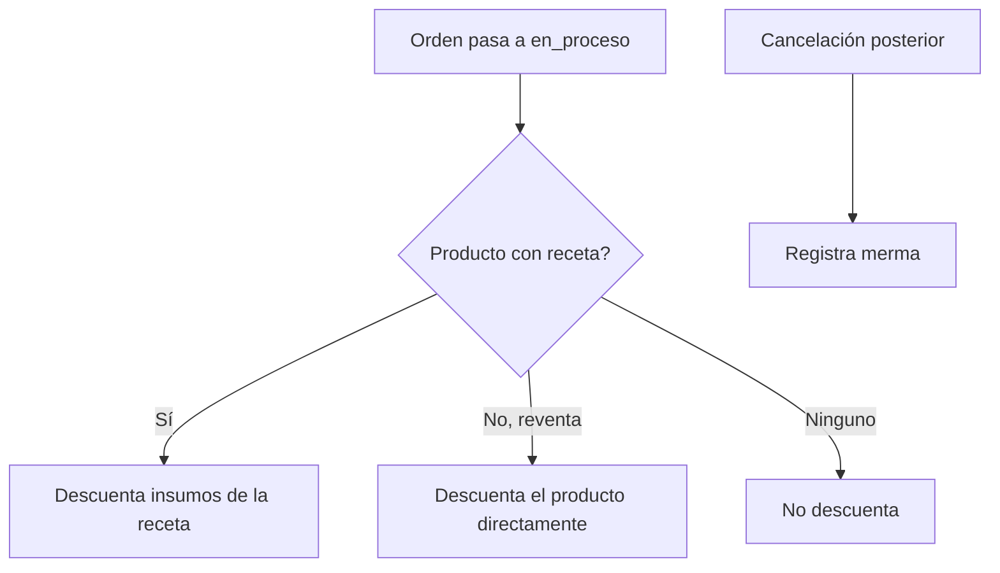

# 22 - Módulo Inventario

**Estado:** Propuesto

Controla **qué insumos y artículos hay, cuánto, cuánto cuestan y cómo se mueven**. Es un módulo contratable por separado (`02A`). Funciona **con o sin recetas** (`14`).

## 1. Qué se controla

| Elemento | Ejemplo |
|---|---|
| **Insumos** | Harina, queso, carne, aceite |
| **Productos de reventa** | Gaseosa de botella, agua, cerveza |
| **Empaques y desechables** | Cajas de pizza, vasos |
| **Suministros** | Servilletas, productos de limpieza (opcional) |

## 2. Datos de un insumo

| Campo | Descripción |
|---|---|
| Nombre y código | Identificación |
| Categoría de insumo | Lácteos, carnes, bebidas, empaques |
| **Unidad base** | Unidad en que se controla (gramo, mililitro, unidad) |
| Unidades de compra | Cómo se compra (bulto de 25 kg, caja de 24) con su **factor de conversión** a la unidad base |
| **Costo** | Costo promedio ponderado actual |
| **Stock mínimo** | Para alertas |
| Ubicación | Bodega, nevera, barra (opcional) |
| Proveedor habitual | Relación con `24` |
| Estado | `activo`, `inactivo` |

## 3. Movimientos de inventario

Todo cambio de stock es un **movimiento** registrado; el stock actual es la suma de movimientos.

| Tipo | Origen | Efecto |
|---|---|---|
| **Entrada por compra** | Recepción de compra (`23`) | + cantidad, recalcula costo |
| **Salida por consumo** | Venta con receta o producto de reventa | − cantidad |
| **Merma** | Daño, desperdicio, vencimiento, pérdida de una orden cancelada | − cantidad, con motivo |
| **Ajuste** | Corrección tras conteo | ± cantidad, con motivo |
| **Traslado** | Entre ubicaciones o restaurantes | − origen, + destino |
| **Devolución a proveedor** | Mercancía devuelta | − cantidad |
| **Producción** | Elaboración de una preparación | − ingredientes, + preparación |

## 4. Costeo

Se propone **costo promedio ponderado**: cada entrada recalcula el costo promedio del insumo. Es simple y suficiente para la mayoría de negocios pequeños. `[POR CONFIRMAR]` con un contador si algún cliente necesita otro método (PEPS).

## 5. Conteos físicos

- **Conteo total o por categoría**: el usuario cuenta, el sistema compara con el teórico y genera **ajustes**.
- **Conteo rotativo**: contar pocas cosas con frecuencia es más realista que un inventario total mensual.
- Cada diferencia se registra con **usuario y motivo** (RG-14).

## 6. Alertas

| Alerta | Cuándo |
|---|---|
| Stock bajo | Por debajo del mínimo |
| Stock negativo | Se vendió más de lo registrado: indica entradas sin registrar o recetas mal cargadas |
| Vencimientos | Si se usan lotes (fase 3) |
| Variación de costo | Un insumo sube de precio de forma notable |

## 7. Relación con ventas

El momento exacto del descuento está en `14`, sección 4. Si no hay inventario contratado, **nada se descuenta** y el sistema funciona igual.

## 8. Realidad operativa

Un inventario es útil **solo si se mantiene al día**. En restaurantes pequeños el riesgo principal es que nadie registre las compras. Por eso:

- Registrar una compra debe ser **muy rápido** (`23`).
- El sistema debe funcionar **sin exigir** recetas completas ni inventario perfecto.
- Los reportes deben dejar claro **qué tan confiable** es cada dato (cobertura de recetas, antigüedad del último conteo).

## 9. Reglas

- **RN-INV-01.** El stock actual es siempre la suma de movimientos; no se edita directamente.
- **RN-INV-02.** Todo ajuste y merma exige motivo y usuario.
- **RN-INV-03.** Las conversiones de unidad tienen factores explícitos; no se mezclan unidades incompatibles.
- **RN-INV-04.** Un insumo con movimientos no se elimina; se inactiva.
- **RN-INV-05.** Stock negativo se permite (para no frenar la venta) pero se alerta.
- **RN-INV-06.** Un traslado entre restaurantes de la misma empresa afecta ambos inventarios.

## 10. Preguntas abiertas

- ¿Inventario por varias bodegas desde el inicio o una sola por restaurante?
- ¿Lotes y fechas de vencimiento? (Recomiendo fase 3.)
- ¿Cómo se maneja el inventario de la comida corriente con ingredientes variables?
