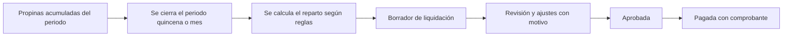

# 26A - Propinas y Liquidaciones

**Estado:** Implementado en la fase 2 (ver ADR-038). **Requiere validación legal.**

Cubre tus requisitos de **propinas de meseros** acumuladas por quincena o mes, la decisión **individual vs. colectiva**, y el **pago a domiciliarios** codificados.

> **Advertencia:** el tratamiento de propinas y del pago a domiciliarios (vínculo laboral o independiente) tiene implicaciones **legales y fiscales**. El sistema calcula y registra según las reglas que el restaurante configure; **no decide qué es legalmente correcto**. Validar con abogado laboral y contador antes de ofrecerlo como solución. `[POR CONFIRMAR]`

## 1. Cómo se capta la propina

| Vía | Registro |
|---|---|
| Propina sugerida al cobrar en caja | Concepto separado en la cuenta (`20`, `21`) |
| Propina con tarjeta o pago en línea | Se registra con su medio de pago |
| Propina en efectivo entregada directamente al mesero | **No pasa por el sistema** salvo que el mesero la declare |

La propina nunca hace parte del valor gravado de la venta por defecto (`RN-FAC-03`).

## 2. Individual vs. colectiva

| Modelo | Cómo funciona | Pros | Contras |
|---|---|---|---|
| **Individual** | Cada propina va al mesero de la cuenta | Simple de calcular; premia el buen servicio | Injusto con cocina y apoyo; peleas por mesas "buenas"; las zonas con menos ventas ganan menos |
| **Colectiva (pozo)** | Todo se acumula y se reparte entre el equipo | Equitativo; incentiva trabajo en equipo; menos conflicto | Se pierde el incentivo individual; exige reglas claras |
| **Mixta** | Parte individual y parte al pozo | Equilibrio | Más compleja de explicar y configurar |

### Recomendación

Para restaurantes pequeños, **soportar los tres como configuración del restaurante**, con **colectiva como valor sugerido por defecto**. Es lo que más reduce conflictos y es fácil de explicar. Pero **es una decisión del dueño**, no del software, y puede estar condicionada por la ley o por los acuerdos con el personal. `[POR CONFIRMAR]`

## 3. Reglas de reparto (para el modelo colectivo)

| Método | Descripción |
|---|---|
| **Por horas trabajadas** | Proporcional a las horas del turno (`08A`) |
| **Por puntos por rol** | Cada rol tiene un peso (mesero 1.0, cocina 0.8, apoyo 0.5, etc.) |
| **Por horas × puntos** | Combina ambos; es el más común y justo |
| **Por zona** | Cada zona reparte su propio pozo |
| **Retención** | Porcentaje que el restaurante retiene para algún fin, solo si está permitido y acordado |

> Cualquier **retención** sobre la propina debe revisarse con asesoría legal: puede estar restringida.

## 4. Periodos y liquidación

| Estado de la liquidación | Significado |
|---|---|
| `abierta` | El periodo sigue acumulando |
| `calculada` | Reparto calculado, editable |
| `aprobada` | Congelada por el administrador |
| `pagada` | Pagada y con comprobante |

- Periodos configurables: **semanal, quincenal, mensual**.
- Cada persona ve el detalle: propinas del periodo, su parte, ajustes.
- Los ajustes manuales exigen **motivo** y se auditan.
- Una liquidación aprobada **no se edita**; se corrige con un ajuste en el siguiente periodo.

## 5. Pago a domiciliarios

| Modelo | Descripción |
|---|---|
| **Tarifa por entrega** | Valor fijo por entrega o por zona de envío (`15B`) |
| **Porcentaje del envío** | Un porcentaje de la tarifa cobrada al cliente |
| **Mixto** | Base fija + variable |

La liquidación suma las **entregas realizadas** en el periodo, resta lo que deba por **rendiciones** pendientes (`15B`) y genera un **comprobante**. Los domiciliarios se identifican por **código**, de modo que "ganen" por cada entrega registrada. Las propinas dadas al domiciliario (si el cliente las deja) se tratan igual que las del equipo o van directo, según configuración.

## 6. Reportes

- Propinas por periodo, por mesero, por zona, por método.
- Liquidación por persona, con detalle.
- Entregas y valor a pagar por domiciliario.
- Totales para el contador.

## 7. Qué no hace este módulo

- **No calcula nómina**: ver `26B`.
- **No reemplaza** el registro laboral de horas ni las obligaciones con seguridad social.
- **No mueve dinero**: solo calcula y registra; el pago se hace fuera del sistema.

## 8. Reglas

- **RN-PRP-01.** La propina se registra como concepto separado y no cuenta como ingreso de ventas.
- **RN-PRP-02.** Las reglas de reparto se versionan; cambiar una regla aplica a periodos nuevos.
- **RN-PRP-03.** Una liquidación aprobada no se modifica (RG-12).
- **RN-PRP-04.** Todo ajuste manual lleva motivo, usuario y momento (RG-14).
- **RN-PRP-05.** Cada persona solo ve su propia liquidación; el administrador ve todas.
- **RN-PRP-06.** Las entregas liquidadas a un domiciliario no se vuelven a liquidar.

## 9. Preguntas abiertas

- ¿Qué porcentaje de las propinas se cobra en efectivo fuera del sistema en tu público objetivo?
- ¿La cocina participa del pozo? ¿Y el cajero y el administrador?
- ¿Cómo se trata la propina en un domicilio pagado en línea?
