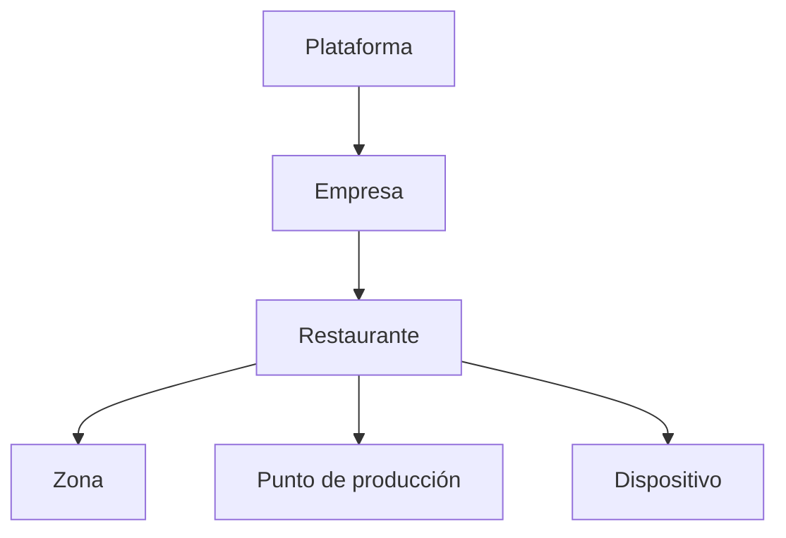

# 28 - Módulo Configuración

**Estado:** Propuesto

Centraliza **cómo se comporta el sistema** para cada empresa, restaurante, zona y dispositivo, sin cambiar código. Evita "constantes escondidas" y hace posible vender el sistema a negocios muy distintos.

## 1. Niveles de configuración

Cada nivel **hereda** del anterior y puede **sobrescribir** solo lo permitido. Ejemplo: el restaurante hereda la zona horaria de la empresa; una zona puede cambiar su modo de aceptación de QR.

## 2. Qué se configura y dónde

| Nivel | Ejemplos |
|---|---|
| **Plataforma** | Catálogo de módulos, planes, textos legales, límites generales, proveedores habilitados |
| **Empresa** | País, moneda y zona horaria por defecto, contacto, preferencias comunes |
| **Restaurante** | Horario, hora de inicio de jornada, impuestos, canales activos, modo de QR por defecto, propina, impresión, medios de pago, pasarela, textos y branding |
| **Zona** | Carta, punto de producción por defecto, modo de aceptación de QR, horario |
| **Punto de producción** | Imprimir al abrir, salto de "en proceso", tiempos objetivo, sonidos |
| **Dispositivo** | Zona o punto asignado, orientación, modo kiosco, volumen |
| **Usuario** | Preferencias de interfaz (idioma, tema) |

## 3. Tipos de ajuste

| Tipo | Ejemplo |
|---|---|
| **Interruptor** | Aceptar órdenes por QR sí/no |
| **Valor** | Tiempo objetivo de preparación en minutos |
| **Lista** | Medios de pago aceptados |
| **Reglas con vigencia** | Tasas de impuestos con fecha de inicio |
| **Texto** | Mensaje de la carta cuando está cerrado |

## 4. Módulos activos

La configuración de **módulos** es especial: solo la modifica la plataforma (el contrato), no el cliente (`02A`). El cliente ve qué módulos tiene y puede **solicitar** nuevos.

## 5. Reglas de buen diseño

- **Valores por defecto sensatos:** un restaurante nuevo debe poder operar sin tocar casi nada.
- **Pocas opciones visibles, el resto "avanzado":** demasiada configuración abruma a un dueño pequeño.
- **Cambios con efecto claro:** cada ajuste explica qué hace y desde cuándo aplica.
- **Auditoría:** cada cambio guarda quién, cuándo y valor anterior (RG-14).
- **Vigencias:** ajustes sensibles (impuestos, jornada) tienen fecha de inicio y no afectan lo pasado (`RN-RES-04`, `RN-RES-05`).

## 6. Asistente inicial

Al crear un restaurante, un asistente guía por lo mínimo: datos básicos, horario, impuestos, zonas y mesas, primera carta, puntos de producción, usuarios (`41`).

## 7. Reglas

- **RN-CFG-01.** Toda configuración tiene un valor por defecto definido.
- **RN-CFG-02.** Un nivel solo puede sobrescribir los ajustes que el nivel superior permite.
- **RN-CFG-03.** Los cambios de configuración se auditan.
- **RN-CFG-04.** Los ajustes con vigencia no alteran documentos ya emitidos.
- **RN-CFG-05.** Los secretos (credenciales de pasarela, proveedor fiscal) se guardan cifrados y no se muestran de nuevo (`32`).

## 8. Preguntas abiertas

- ¿Cuántos ajustes se exponen en el MVP? (Recomiendo menos de los que parezcan necesarios.)
- ¿Se permite exportar e importar configuración entre restaurantes?
