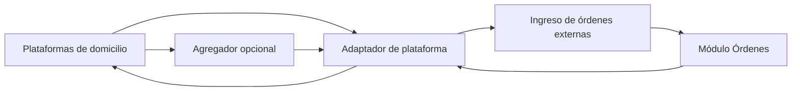

# 31A - Integraciones Externas

**Estado:** Propuesto (fase 3). **Requiere verificación con cada plataforma.**

Tu documento pedía **conectar la aplicación con Rappi, Uber Eats y otras plataformas**. Este documento explica qué se necesita, qué opciones hay, y **qué no puedo confirmar**.

## 1. Qué significa "integrar" con una plataforma de domicilios

| Función | Descripción |
|---|---|
| **Recibir órdenes** | Las órdenes hechas en la plataforma aparecen en tu sistema como órdenes externas |
| **Sincronizar el menú** | Publicar productos, precios y disponibilidad en la plataforma desde tu sistema |
| **Sincronizar estados** | Aceptar, preparar, listo para recoger: el estado de tu sistema se refleja en la plataforma |
| **Disponibilidad** | Pausar o abrir el restaurante, marcar productos agotados |
| **Conciliación** | Cruzar ventas y comisiones con los reportes de la plataforma |

## 2. Lo que sé y lo que **no puedo confirmar**

| Tema | Estado |
|---|---|
| Que Rappi, Uber Eats y plataformas similares **tienen** programas de integración para socios de tecnología | Es habitual en el sector; **verificar** su existencia y requisitos actuales en cada país |
| Si el acceso a sus APIs es **abierto** o requiere **ser aliado aprobado** | **No lo puedo confirmar.** Normalmente hay un proceso de aprobación y requisitos comerciales o técnicos |
| Costos, comisiones y requisitos contractuales | **No los conozco con exactitud.** Dependen de cada plataforma y país |
| Formatos exactos de API, webhooks y certificaciones | **Verificar con documentación oficial** y con el contacto comercial |
| Si estas plataformas permiten integración directa para un software pequeño | **Incierto**; muchas se apoyan en intermediarios |

> **No construir nada antes de tener respuesta por escrito de cada plataforma.** Hacer ingeniería inversa o automatizar sus paneles web (extracción de pantalla) suele **violar los términos de servicio** y puede provocar el cierre de la cuenta del restaurante. **No lo recomiendo.**

## 3. Estrategias posibles

| Estrategia | Descripción | Pros | Contras |
|---|---|---|---|
| **A. Integración directa** | Tu sistema se conecta a la API de cada plataforma | Control total, sin intermediario | Cada plataforma exige aprobación y mantenimiento propio |
| **B. Agregador / middleware** | Un servicio intermedio conecta varias plataformas y te ofrece una sola API | Una integración en vez de varias; ya tienen relaciones con las plataformas | Costo por pedido o suscripción; dependencia; no siempre disponible en tu país |
| **C. Flujo manual asistido** | Una persona recibe en la tableta de la plataforma y **digita** la orden en tu sistema | Cero integración, funciona hoy | Doble digitación, errores, lentitud |
| **D. Reportes manuales** | Solo se importa el reporte de ventas de la plataforma para contabilidad | Muy simple | No gestiona órdenes en vivo |

**Recomendación:** empezar con **C y D** para tus primeros clientes, **mientras averiguas** si hay un agregador disponible en tu mercado o si alguna plataforma aprueba un acceso directo. Entre **A** y **B**, para un equipo pequeño **B suele ser más sensato** si existe y si el costo lo permite. `[POR CONFIRMAR]`

## 4. Arquitectura propuesta

Cualquier integración se hace tras un **adaptador** (ADR-011):

- Las órdenes entran como **canal "plataforma"** y siguen el flujo normal (`17A`).
- El adaptador **traduce estados** de tu sistema a los de la plataforma y viceversa.
- Los webhooks se verifican y se procesan en segundo plano (`31`).
- Debe existir un **modo manual de contingencia**: si la integración falla, una persona puede aceptar la orden desde la tableta de la plataforma sin frenar la cocina.

## 5. Desafíos específicos

| Desafío | Detalle |
|---|---|
| **Menús distintos por plataforma** | Cada una tiene sus reglas de categorías, modificadores y precios; el mapeo es trabajo constante |
| **Precios con comisión** | Muchos restaurantes suben el precio en la plataforma; hay que soportar precios por canal |
| **Tiempos de aceptación** | Las plataformas exigen aceptar una orden en pocos minutos; la integración debe ser fiable |
| **Repartidores ajenos** | El repartidor lo envía la plataforma; no entra en tu módulo de domicilios (`15B`) |
| **Cobro** | La plataforma cobra al cliente y paga al restaurante con comisión; la caja debe reflejar eso, no como efectivo |
| **Cancelaciones** | La plataforma puede cancelar o modificar; hay que reflejarlo en `16` |
| **Facturación** | Quién factura qué (restaurante a la plataforma, plataforma al cliente) debe validarlo un contador |

## 6. Plan de trabajo sugerido (cuando llegue la fase)

1. Hablar con representantes comerciales de cada plataforma y preguntar **por escrito** requisitos y costos de integración.
2. Investigar **agregadores** disponibles en tu mercado.
3. Elegir **una** plataforma para empezar, la que más usen tus clientes.
4. Pilotear con **un restaurante** y flujo manual de contingencia.
5. Medir tiempos, errores y costo real antes de ampliar.

## 7. Preguntas para las plataformas y agregadores

1. ¿Tienen programa de integración para proveedores de software? ¿Requisitos y plazos?
2. ¿Qué datos entregan por orden y por webhook?
3. ¿Soportan sincronización de menú y disponibilidad?
4. ¿Cuánto cuesta (comisiones, suscripción, certificación)?
5. ¿Hay ambiente de pruebas?
6. ¿Qué pasa si mi servicio se cae durante una orden?
7. ¿Existen límites de uso?

## 8. Reglas

- **RN-INT-01.** Toda integración externa se accede por un adaptador con interfaz propia (ADR-011).
- **RN-INT-02.** Las órdenes de plataformas se marcan con canal y referencia externa; nunca se mezclan con otros canales.
- **RN-INT-03.** Las credenciales de integración se guardan cifradas por restaurante.
- **RN-INT-04.** Ninguna integración puede bloquear la operación local si la plataforma falla.
- **RN-INT-05.** No se usan métodos que violen los términos de servicio de las plataformas.
