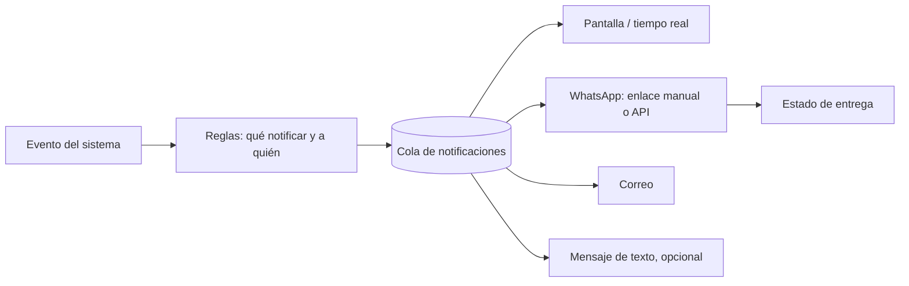

# 31B - Notificaciones y WhatsApp

**Estado:** Propuesto (fase 2). **Requiere verificar costos y reglas vigentes de WhatsApp.**

Tu documento pedía que el sistema **avise por WhatsApp** al cliente cuando su orden está lista o cuando el domicilio salió. Este documento define las notificaciones y cómo resolver WhatsApp sin riesgos innecesarios.

## 1. Notificaciones del sistema

| Notificación | Destinatario | Canal | Fase |
|---|---|---|---|
| Orden recibida | Cliente | Pantalla de la carta digital | MVP |
| Estado actualizado (en proceso, lista) | Cliente | Pantalla de la carta digital | MVP |
| Orden de QR pendiente de aprobación | Mesero | Tablet (aviso destacado) | MVP |
| Comanda nueva | Producción | Pantalla y sonido | MVP |
| Comanda despachada | Mesero | Tablet | MVP |
| **Tu orden está lista para recoger** | Cliente | WhatsApp | 2 |
| **Tu orden salió a domicilio** | Cliente | WhatsApp | 2 |
| Entrega fallida | Cliente y encargado | WhatsApp y pantalla | 2 |
| Cupón o promoción | Cliente con consentimiento | WhatsApp | 2 |
| Alertas operativas (stock bajo, caja) | Administrador | Pantalla y, opcional, WhatsApp o correo | 2 |
| Resumen diario | Dueño | WhatsApp o correo | 2 |

## 2. Opciones para WhatsApp

| Opción | Descripción | Pros | Contras |
|---|---|---|---|
| **A. API oficial (WhatsApp Business Platform de Meta)** | El sistema envía mensajes automáticos por la API oficial, directamente o mediante un proveedor autorizado | Soportada, estable, con plantillas aprobadas | Registro del negocio, **plantillas aprobadas por Meta**, **costo por mensaje** según tarifas vigentes, requisitos de consentimiento |
| **B. Enlace "click to chat" con mensaje prellenado** | El encargado pulsa un botón y se abre WhatsApp (en su celular o web) con el mensaje ya escrito; solo debe pulsar enviar | **Sin costo, sin riesgo de bloqueo, sin integración** | No es automático: lo hace una persona |
| **C. Herramientas no oficiales** (automatizar WhatsApp Web, librerías no autorizadas) | Envíos automáticos sin la API oficial | Aparentemente barato y rápido | **Riesgo real de bloqueo del número** del restaurante; viola los términos de uso; frágil. **No recomiendo** |

### Recomendación por fases

- **MVP y fase 1:** **opción B**. Es gratis, segura y resuelve el 80% de la necesidad: botón "Avisar al cliente" en la orden.
- **Fase 2:** **opción A** cuando haya clientes que pagarían por la automatización y se haya verificado el costo por mensaje.
- **Nunca C** en un producto comercial.

> **Lo que no puedo confirmar:** tarifas actuales por mensaje, categorías de plantillas y requisitos de verificación de negocio de la API oficial. Cambian con frecuencia. **Verificar la documentación oficial y las tarifas** antes de fijar precios al cliente. `[POR CONFIRMAR]`

## 3. Plantillas de mensaje (propuestas)

Los textos son configurables por restaurante. En la API oficial deben aprobarse como plantillas.

| Evento | Texto base |
|---|---|
| Lista para recoger | "Hola {nombre}, tu orden #{numero} en {restaurante} está lista para recoger." |
| Salió a domicilio | "Hola {nombre}, tu orden #{numero} de {restaurante} ya va en camino." |
| Entrega fallida | "Hola {nombre}, no pudimos entregar tu orden #{numero}. Escríbenos para coordinar." |
| Confirmación de orden | "Recibimos tu orden #{numero}. Te avisaremos cuando esté lista." |

## 4. Consentimiento

- Las notificaciones **transaccionales** (sobre una orden que el cliente hizo) se justifican por la relación con ese pedido, pero **debe informarse** que se usará su teléfono para eso (`32A`).
- Las **comunicaciones comerciales** (cupones, promociones) requieren **consentimiento expreso** y registro (`RN-CLI-04`).
- Debe existir una forma sencilla de **dejar de recibir** mensajes.

## 5. Diseño del servicio de notificaciones

- **Cola con reintentos** y registro del resultado (enviado, entregado, fallido).
- **Adaptador** por canal (ADR-011): se puede cambiar de proveedor.
- Una **notificación fallida nunca bloquea** la operación; se muestra al encargado para que avise manualmente.
- Límite de mensajes por cliente para evitar abusos.

## 6. Reglas

- **RN-NOT-01.** Una falla de notificación nunca detiene una orden.
- **RN-NOT-02.** No se envían mensajes comerciales sin consentimiento registrado.
- **RN-NOT-03.** Los mensajes se registran con destinatario, momento, plantilla y resultado.
- **RN-NOT-04.** Cada restaurante puede activar o desactivar cada tipo de notificación.
- **RN-NOT-05.** El teléfono de un cliente se valida en formato antes de usarlo.

## 7. Preguntas abiertas

- ¿Quién paga el costo por mensaje en la API oficial: el restaurante o el proveedor del software?
- ¿Cada restaurante usa su propio número de WhatsApp Business o uno del proveedor? (Recomiendo el del restaurante.)
- ¿Se necesitan respuestas automáticas a mensajes entrantes (por ejemplo, tomar pedidos por chat)? Fuera del alcance actual.
