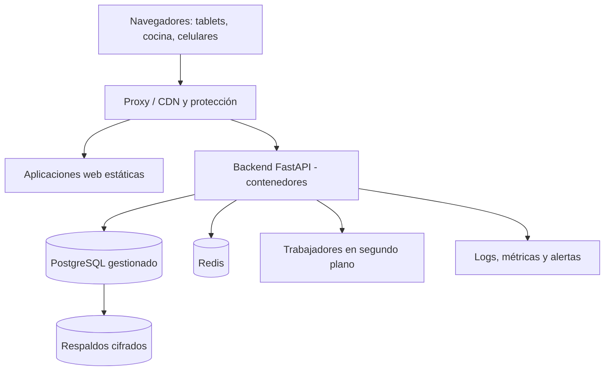

# 40 - Despliegue y Operación

**Estado:** Propuesto

Cómo se **publica, se vigila y se mantiene** el sistema. El hosting concreto está **pendiente**: aquí se definen criterios y una forma de trabajar razonable para un equipo pequeño.

## 1. Principio

Un restaurante usa el sistema **en horas pico**: almuerzo, noche, fines de semana. **Los cambios y las fallas deben evitar esas horas.** Operar bien importa tanto como programar bien.

## 2. Entornos

| Entorno | Para qué | Datos |
|---|---|---|
| **Desarrollo** | Programar y probar local | Datos de prueba |
| **Pruebas / staging** | Probar versiones completas, simular un restaurante, mostrar a clientes del piloto | Datos de prueba |
| **Producción** | Clientes reales | Datos reales (`RN-SEG-04`) |

Cada entorno tiene **sus propios secretos y bases de datos**. Staging se parece lo más posible a producción.

## 3. Infraestructura (visión)

- **Contenedores** (Docker) para consistencia entre entornos.
- **Base de datos gestionada** (con respaldos y recuperación a un punto en el tiempo) si el presupuesto lo permite: reduce mucho el riesgo.
- **Aplicaciones web estáticas** servidas por un CDN o proxy.
- **Trabajadores** separados para tareas pesadas o diferidas (facturación, notificaciones, reportes).

## 4. Elección del hosting (pendiente, ADR por abrir)

| Criterio | Qué revisar |
|---|---|
| **Ubicación** | Latencia hacia los clientes; implicaciones de datos personales (`32A`) |
| **Bases de datos gestionadas** | Respaldos, alta disponibilidad, recuperación |
| **Costo** | Modelo predecible para empezar y para crecer |
| **Simplicidad operativa** | Equipo pequeño: preferir servicios gestionados |
| **Escalabilidad** | Poder aumentar recursos sin rehacer todo |
| **Soporte y reputación** | Estabilidad y trayectoria |

Opciones típicas: una nube pública grande, una plataforma de despliegue gestionado (PaaS) o un VPS administrado. **No hay una opción única correcta**; depende de presupuesto y de la experiencia del equipo. `[POR CONFIRMAR]`

## 5. Despliegue

- **Despliegue automatizado** desde el repositorio tras pasar las pruebas (`39`).
- **Migraciones de base de datos** versionadas, **compatibles hacia atrás** (que la versión anterior siga funcionando durante el cambio) para evitar caídas.
- **Despliegues sin interrupción** cuando sea posible (actualización gradual).
- **Ventanas de despliegue fuera de horas de servicio** (por ejemplo en la mañana), con aviso a los clientes si hay riesgo.
- **Marcha atrás (rollback)** rápida y probada.
- **Banderas de funcionalidad** (feature flags) para activar cambios de forma gradual por cliente.
- Las **aplicaciones web instaladas como PWA** deben actualizarse sin dejar tablets con versión vieja incompatible: estrategia de actualización de la aplicación y de versión mínima soportada.

## 6. Respaldos y recuperación

| Aspecto | Propuesta |
|---|---|
| **Frecuencia** | Respaldos automáticos diarios y recuperación a un punto en el tiempo |
| **Cifrado** | En tránsito y en reposo |
| **Ubicación** | En otra zona o proveedor distinto al principal |
| **Retención** | Definida y comunicada a los clientes |
| **Pruebas de restauración** | **Periódicas**, documentadas: un respaldo que nunca se ha probado no existe |
| **Metas (hipótesis a validar)** | Pérdida máxima aceptable (RPO) y tiempo máximo de recuperación (RTO) definidos con los clientes del piloto |

## 7. Monitoreo y alertas

| Qué se vigila | Ejemplos |
|---|---|
| **Disponibilidad** | La API y las aplicaciones responden |
| **Rendimiento** | Tiempos de respuesta, latencia del tiempo real |
| **Errores** | Tasa de errores, excepciones agrupadas |
| **Negocio** | Órdenes creadas por minuto, órdenes fallidas, cobros fallidos, colas de impresión y notificaciones |
| **Recursos** | CPU, memoria, conexiones a la base de datos, espacio |
| **Seguridad** | Intentos de acceso fallidos, abusos de endpoints públicos |
| **Dispositivos** | Pantallas de cocina desconectadas por mucho tiempo (alerta al restaurante) |

Alertas **accionables**: pocas, con responsable y pasos a seguir. Una alerta que nadie atiende es ruido.

## 8. Estado del servicio y comunicación

- **Página de estado** pública con incidentes y mantenimientos.
- **Aviso** a los clientes antes de mantenimientos programados.
- **Canal de soporte prioritario** durante incidentes (`41`).

## 9. Secretos y configuración

- Secretos fuera del código, en un gestor de secretos.
- Rotación periódica y tras cualquier incidente.
- Credenciales de integraciones por restaurante cifradas (`28`, `RN-SEG-01`).
- Acceso mínimo a producción, con registro.

## 10. Costos

Rubros a estimar antes de fijar precios (`42`), **sin cifras asumidas aquí**:

- Cómputo y base de datos.
- Respaldos y almacenamiento.
- CDN y ancho de banda.
- Monitoreo y logs.
- Servicios externos por uso (facturación electrónica, WhatsApp, pasarela, mapas si se usan).
- Dominio y certificados.
- Herramientas de desarrollo y pruebas.
- Soporte y tiempo humano.

Calcular el **costo por restaurante activo** y su evolución con el uso.

## 11. Manuales de operación (runbooks)

Guías paso a paso para situaciones esperables:

- Servicio caído o lento.
- Base de datos llena o lenta.
- Restaurar un respaldo.
- Una pantalla de cocina no recibe comandas.
- Webhook de pago no llega.
- Revocar masivamente QR o dispositivos.
- Rotar una credencial comprometida.
- Desactivar un módulo o un cliente por falta de pago (`02A`).

## 12. Reglas

- **RN-OPS-01.** No se despliega durante horas pico de los clientes sin autorización explícita.
- **RN-OPS-02.** Toda migración de base de datos se prueba en staging con datos representativos.
- **RN-OPS-03.** Los respaldos se prueban de forma periódica y el resultado queda registrado.
- **RN-OPS-04.** Todo cambio en producción es trazable a un cambio en el repositorio.
- **RN-OPS-05.** Un incidente grave termina con revisión posterior y acciones correctivas.

## 13. Preguntas abiertas

- ¿Qué proveedor de nube y qué región?
- ¿Qué herramientas de logs, métricas y errores?
- ¿Quién atiende alertas fuera de horario? Con un equipo pequeño, definir qué se atiende y qué espera al día siguiente.
