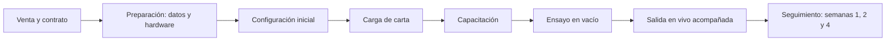

# 41 - Onboarding y Soporte

**Estado:** Propuesto

Cómo se **pone en marcha un restaurante nuevo** y cómo se le **da soporte**. En software para negocios pequeños, la mayoría de los clientes se pierde en las primeras dos semanas por mala puesta en marcha, no por falta de funciones.

## 1. Principio

Un restaurante debe poder **operar su primer servicio real en pocos días**, con acompañamiento. Cada fricción en el arranque se paga en cancelaciones.

## 2. Etapas del onboarding

### 2.1 Venta y contrato

- Alcance claro: módulos contratados (`02A`), periodo de prueba, condiciones.
- Aceptación de términos, política de tratamiento y contrato de encargo de datos (`32A`).
- Alta de empresa, restaurante y administrador por el proveedor (`06`).

### 2.2 Preparación

**Datos que pedir al cliente:**

- Datos del restaurante y fiscales.
- Horario y hora de inicio de jornada.
- Zonas, número de mesas y cómo se llaman.
- Carta en cualquier formato (hoja de cálculo, PDF, fotos).
- Personal y sus roles.
- Impuestos que aplican (con su contador).
- Zonas de domicilio y tarifas, si aplica.

**Revisión del entorno físico** (`33A`, `32`):

| Tema | Qué verificar |
|---|---|
| Internet | Velocidad y estabilidad en cocina, barra, salón; recomendar un respaldo con datos móviles |
| Wi-Fi | Red separada para el sistema, con cobertura en todas las zonas |
| Tablets | Cantidad, modelo y sistema operativo; soporte de navegador |
| Pantalla de cocina | Tamaño, ubicación, soporte, alimentación |
| Impresoras | Modelos, conexión, papel (`19A`) |
| Teléfonos del personal | Para pruebas de QR y del encargado de WhatsApp |

### 2.3 Configuración inicial

Asistente guiado: restaurante, horario, impuestos, zonas y mesas (creación en lote), puntos de producción, usuarios y roles, dispositivos emparejados, canales activos (`28`).

### 2.4 Carga de carta

- **Importación desde hoja de cálculo** (plantilla proporcionada) o carga asistida por el proveedor.
- Categorías, productos, precios, modificadores, puntos de producción.
- Fotos opcionales.
- Revisión conjunta con el dueño antes de publicar.
- Las recetas e inventario se cargan **después**, gradualmente (`14`).

### 2.5 QR y material

- Generar e imprimir los QR de las mesas y de los canales externos (`10A`).
- Sugerencia de material resistente y de ubicación visible.
- Guía de uso para el cliente final ("Escanea para pedir").

### 2.6 Capacitación

| Rol | Contenido | Duración orientativa |
|---|---|---|
| **Meseros** | Tablet, PIN, tomar órdenes, aprobar QR, entregar | Corta, práctica y repetida |
| **Cocina / bar** | Pantalla, abrir, despachar, imprimir, agotados | Corta |
| **Cajero / encargado de externos** | Cobro, turnos, órdenes externas, domicilios | Media |
| **Administrador** | Configuración, informes, auditoría, cierre de jornada | Media |

Se entregan **guías visuales de una página** por rol (más útiles que manuales largos), y el **plan de contingencia manual** (`33A`).

### 2.7 Ensayo en vacío

Simular una jornada **sin clientes**: órdenes de prueba por todos los canales, cocina, entrega, cobro y cierre. Se detectan configuraciones erróneas y se genera confianza.

### 2.8 Salida en vivo acompañada

- Primer servicio real con **presencia o contacto directo** del soporte.
- Preferible un día de **poco volumen**.
- Mantener el **método anterior en paralelo** (papel o sistema previo) los primeros días como respaldo.

### 2.9 Seguimiento

- **Día 1:** revisión de lo ocurrido.
- **Semana 1, 2 y 4:** llamada o visita con revisión de indicadores de uso y problemas.
- **Mes 2 o 3:** conversación sobre módulos adicionales.

## 3. Indicadores de salud del cliente

| Indicador | Señal |
|---|---|
| Porcentaje de órdenes pasando por el sistema | Si baja, hay problema de adopción |
| Uso de cada canal y módulo | Dónde está obteniendo valor |
| Cierres de jornada realizados | Disciplina operativa |
| Errores y reintentos | Calidad técnica |
| Tickets de soporte | Fricción |
| Usuarios activos | Participación del equipo |

## 4. Soporte

### Canales

| Canal | Uso | Observación |
|---|---|---|
| **Ayuda dentro de la aplicación** | Guías cortas y contacto | Fase 1 |
| **WhatsApp o chat** | Consultas rápidas | Muy usado por restaurantes; definir horario |
| **Correo o formulario** | Casos no urgentes | Registro |
| **Teléfono / videollamada** | Incidentes y capacitación | Para casos críticos |
| **Base de conocimiento** | Guías, preguntas frecuentes | Fase 2 |

### Niveles de severidad (propuesta)

| Nivel | Ejemplo | Respuesta objetivo (hipótesis) |
|---|---|---|
| **Crítico** | Restaurante no puede tomar o despachar órdenes | Inmediata, durante horas de servicio |
| **Alto** | Función importante degradada (impresión, cobro) | Pocas horas |
| **Medio** | Error con alternativa | Mismo día o siguiente |
| **Bajo** | Duda o mejora | Dentro de días |

> Los tiempos exactos dependen de los **recursos reales** del equipo. **No prometas lo que no puedes cumplir**: define un acuerdo de servicio (SLA) realista antes de venderlo (`42`).

### Horario de soporte

Los restaurantes operan **tardes, noches y fines de semana**, justo cuando un equipo pequeño suele descansar. Decidir desde el inicio qué cobertura se ofrece, con qué costo y cómo se informa.

### Gestión de casos

- Registro de cada caso con restaurante, severidad, causa y solución.
- Etiquetas para detectar **problemas repetidos** que deban corregirse en el producto.
- Revisión mensual de causas principales.

## 5. Retroalimentación al producto

- Canal para **sugerencias**; revisión periódica.
- Las observaciones de campo alimentan `38`, `35` y `36`.
- Antes de agregar una función, preguntar cuántos clientes la piden y qué problema resuelve.

## 6. Salida del cliente (offboarding)

- Exportación de datos (órdenes, clientes, productos, reportes) en formatos abiertos.
- Plazo de conservación y eliminación según contrato (`32A`).
- Entrevista de salida para entender el motivo.
- Revocar accesos, dispositivos y credenciales de integraciones.

## 7. Reglas

- **RN-ONB-01.** Ningún restaurante entra en producción sin ensayo en vacío.
- **RN-ONB-02.** Cada cliente tiene un responsable de la relación y un plan de contingencia manual entregado.
- **RN-ONB-03.** Cada incidente crítico tiene registro y revisión posterior.
- **RN-ONB-04.** Los datos del cliente se exportan completos al terminar el contrato, si los solicita.

## 8. Preguntas abiertas

- ¿Quién hace el onboarding: el propio desarrollador o un equipo? Con pocos clientes, será el desarrollador, lo que **limita cuántos restaurantes se pueden incorporar al mes**.
- ¿Se cobra el onboarding o va incluido?
- ¿Qué cobertura de soporte en horarios de servicio se puede sostener?
